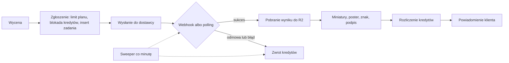

# AIVENOVA: plan budowy platformy generatywnej klasy Higgsfield

Stan: wersja 1 z 2026-11-13. Autor: sesja planistyczna na podstawie dziewięciu raportów badawczych w [`docs/research/`](research/).

Ten dokument odpowiada na pytanie: jak jedna osoba z kontami Vercel i Supabase może zbudować produkt, który robi to samo co Higgsfield, i w jakiej kolejności to robić, żeby po drodze zacząć zarabiać. Liczby pochodzą z raportów badawczych; przy każdej ważniejszej podaję źródło (R01–R09) i poziom pewności. Szacunki czasu i kosztów są moimi szacunkami, a nie zobowiązaniem.

## Spis treści

1. [Podsumowanie](#1-podsumowanie)
2. [Co znaczy „kopia” i czego nie kopiujemy](#2-co-znaczy-kopia-i-czego-nie-kopiujemy)
3. [Anatomia Higgsfield](#3-anatomia-higgsfield)
4. [Strategia: gdzie da się wygrać](#4-strategia-gdzie-da-się-wygrać)
5. [Mapa parytetu funkcji](#5-mapa-parytetu-funkcji)
6. [Architektura](#6-architektura)
7. [Modele i dostawcy](#7-modele-i-dostawcy)
8. [Kredyty, cennik, płatności](#8-kredyty-cennik-płatności)
9. [Prawo i bezpieczeństwo treści](#9-prawo-i-bezpieczeństwo-treści)
10. [Produkt i UX](#10-produkt-i-ux)
11. [Harmonogram: etapy 0–8](#11-harmonogram-etapy-08)
12. [Wejście na rynek](#12-wejście-na-rynek)
13. [Budżet i próg rentowności](#13-budżet-i-próg-rentowności)
14. [Ryzyka](#14-ryzyka)
15. [Decyzje do podjęcia](#15-decyzje-do-podjęcia)
16. [Pierwsze 14 dni](#16-pierwsze-14-dni)
17. [Mierniki](#17-mierniki)
18. [Indeks raportów](#18-indeks-raportów)

---

## 1. Podsumowanie

1. **Higgsfield jest agregatorem, a nie laboratorium modeli.** Jego katalog to 140 definicji modeli od ok. 23 dostawców (Kling, Google, ByteDance, OpenAI, Black Forest Labs, ElevenLabs i inni); 27 pozycji nosi markę Higgsfield, a część z nich jawnie działa na cudzych modelach (R01, R02, pewność wysoka). Wartość firmy leży w warstwie nad modelami: jednolity katalog, presety, studia, kredyty, agent.
2. **Tę warstwę da się odtworzyć.** Cały produkt sprowadza się do pięciu abstrakcji: rejestr modeli, zadanie generacji, preset, biblioteka elementów, runner potoków. Gdy one istnieją, większość nowych funkcji dodaje się jako dane, a nie kod (R02, R09).
3. **Trzech rzeczy nie da się odtworzyć i nie należy próbować:** ceny (Higgsfield sprzedaje generacje za ok. 50–75% cennikowego kosztu API, R04), szerokości (172 narzędzia, ok. 1 100 presetów, zespół 160–650 osób, R01/R02) oraz promocji „unlimited” finansowanych kapitałem.
4. **Strategia: ten sam silnik, węższy front.** Budujemy silnik o architekturze Higgsfield, a pierwszym studiem jest polskie studio reklam produktowych dla sklepów internetowych, marketerów i agencji: ceny w PLN przed każdą generacją, BLIK, faktura VAT, kredyty z rolloverem, zwrot za nieudane generacje (R07).
5. **Stack:** Next.js 16 na Vercel Pro (region `fra1`), Supabase Pro w UE, media w Cloudflare R2, orkiestracja w Vercel Workflow ze sweeperem w `pg_cron`, modele przez fal.ai i Vercel AI Gateway, płatności przez Stripe (R03, R04, R05).
6. **Zakres startowy:** 10–15 modeli i 30–50 własnych presetów zamiast 140 modeli i 1 100 presetów (R02).
7. **Ekonomia:** 1 kredyt to ok. 0,01 USD wartości detalicznej; plany 10 / 29 / 79 USD; wkład ok. 8,9 USD na płacącego miesięcznie; próg rentowności ok. 30 płacących przy 250 USD kosztów stałych i ok. 560 przy 5 000 USD (R04, szacunek).
8. **Bramki prawne od pierwszego dnia:** maszynowe oznaczanie każdego wyniku (AI Act art. 50), polityka „zero NSFW” (wymóg Stripe), wyraźna zgoda na przetwarzanie twarzy i głosu, spółka z o.o. przed publicznym startem (R06).
9. **Czas (szacunek dla jednej osoby na pełen etat):** zamknięta beta z płatnościami po 8–11 tygodniach, publiczny start ze studiem reklam po 15–20 tygodniach, agent z MCP i API po 21–28 tygodniach.
10. **Od Ciebie potrzebuję ośmiu decyzji** (sekcja 15). Najważniejsze: czy akceptujesz klin „reklamy produktowe dla e-commerce”, nazwę i domenę, oraz czy funkcje z wizerunkiem i głosem realnych osób odkładamy na później.

---

## 2. Co znaczy „kopia” i czego nie kopiujemy

Budowa funkcjonalnego odpowiednika istniejącej usługi jest legalna: idee, funkcje i zasady działania nie podlegają ochronie. Ryzykowne albo bezprawne jest kopiowanie tego, co stanowi cudzą twórczość lub oznaczenie (R06, do potwierdzenia z prawnikiem).

| Wolno | Nie wolno |
|---|---|
| Odtworzyć funkcje: katalog modeli, presety, kredyty, studia, agent | Używać znaków, nazw produktów i nazw presetów konkurenta |
| Przejąć ogólne wzorce UX (koszt przed generacją, karta zadania w feedzie) | Powielać wygląd: ciemny motyw z limonkowym CTA, te same kroje, układ 1:1 |
| Korzystać z tych samych zewnętrznych modeli przez własne umowy | Kopiować teksty, prompty, miniatury, media i kod |
| Porównywać się obiektywnie (cechy, ceny) | Reklamować się jako „kopia” lub „klon” (art. 16 ust. 3 ustawy o zwalczaniu nieuczciwej konkurencji) |
| Analizować publicznie dostępne informacje | Używać konta, API lub konektora konkurenta jako zaplecza produktu albo do ekstrakcji treści |

**Zasada „clean room” obowiązuje w całym repozytorium:**

- Do kodu, treści i zasobów produktu nie trafia żaden tekst, prompt, nazwa presetu ani plik pozyskany z Higgsfield. Własne nazwy, własne prompty, własne media.
- Raporty w `docs/research/` opisują konkurenta wyłącznie jako materiał analityczny. Repozytorium powinno pozostać prywatne.
- API Higgsfield nie jest źródłem podaży: ich regulamin traktuje redystrybucję dostępu deweloperskiego jako istotne naruszenie (R03).
- Historia git jest dowodem niezależnej twórczości, więc commitujemy często i opisowo.

Nazwa AIVENOVA jest w tym dokumencie nazwą roboczą. Przed zakupem domeny i startem trzeba zlecić badanie znaku (EUIPO, TMview, klasy 9, 41, 42).

---

## 3. Anatomia Higgsfield

### 3.1 Skala

| Wymiar | Wartość | Źródło |
|---|---|---|
| Definicje modeli | 140: 60 wideo, 51 obraz, 18 3D, 11 audio | R02, odczyt katalogu, pewność wysoka |
| Dostawcy | ok. 23 nazwanych; 27 pozycji z marką własną; 26 narzędzi bez dostawcy | R02 |
| Presety | ok. 1 090 policzonych, w tym 649 szablonów marketingowych i 87 efektów wideo | R02 |
| Wieloetapowe workflowy | 23 (reklamy, UGC, montaż, dubbing, budowa stron) | R02 |
| Narzędzia w konektorze MCP | 172 w 21 domenach | R02 |
| Deklarowany przychód | run rate 1,35 mld USD (10.2026), nieaudytowany | R01, pewność średnia |
| Użytkownicy | 32 mln+, prawie 1 mln płacących (deklaracja) | R01, pewność średnia |
| Zespół | 160–650 osób (źródła rozbieżne) | R01 |
| Tempo | wpis w changelogu co 1–2 dni; nowy model 0–1 dnia po udostępnieniu API | R01 |

### 3.2 Cztery warstwy produktu

1. **Katalog modeli zewnętrznych** z jednolitym schematem: parametry, role mediów (klatka startowa, końcowa, referencje obrazu, wideo, audio), proporcje, czas.
2. **Potoki pod własną marką.** Część to własne modele (fotorealistyczny model obrazu z treningiem tożsamości), część to opakowane cudze modele z dodatkowymi słownikami sterującymi promptem.
3. **Studia i presety**, czyli formularze nad potokami. Preset ma jedną z trzech postaci: przepis (model, zablokowane parametry, stały prompt, jedno zdjęcie), styl albo łańcuch kroków ze slotami wejść opisanymi przez JSON Schema.
4. **Agent i dystrybucja**: czat orkiestrujący narzędzia, serwer MCP, publiczne API, canvas.

Kluczowa obserwacja z R02: definicja modelu jest czystymi danymi i nie zawiera cen. Koszt liczy osobny krok wyceny przed wysłaniem, a stawki żyją w osobnej tabeli reguł. To jest architektura, którą przejmujemy.

### 3.3 Skąd biorą się pieniądze

- 85% użycia pochodziło od marketerów social media (01.2026, R01).
- Udział subskrypcji w przychodzie spadł z ponad 90% do ok. 60%; resztę dają doładowania i użycie na żądanie (R01).
- Najmocniej rozwijane w drugiej połowie 2026: flagowe modele wideo, studio marketingowe i reklamowe, trening postaci, efekty viralowe jako kanał akwizycji (R01, wnioskowanie).

Wniosek: pieniądze są w marketingu i w dokupywanych kredytach, a nie w samej galerii modeli.

### 3.4 Słabe punkty, które są dla nas okazją

| Słaby punkt | Źródło |
|---|---|
| Plan darmowy bez kredytów | R01 |
| Kredyty z planu przepadają co miesiąc; doładowania wygasają po 90 dniach | R01, R02 |
| Skargi na domyślnie zaznaczony plan roczny i wąskie okno zwrotu | R04, R07 |
| „Unlimited” to czasowe okna na wybrane modele z terminem zakupu | R04 |
| Cennik tylko w USD, brak polskiego interfejsu | R07 |
| Brak natywnej aplikacji mobilnej | R01 |

---

## 4. Strategia: gdzie da się wygrać

### 4.1 Niewygodna matematyka

Higgsfield sprzedaje generacje taniej, niż nowy gracz jest w stanie je kupić (R04, pewność średnia):

| Generacja | Cena detaliczna Higgsfield | Cennikowy koszt API | Relacja |
|---|---|---|---|
| Obraz premium (Nano Banana Pro) | 0,07–0,10 USD | 0,134 USD | 49–73% |
| Wideo 5 s (Kling 3.0) | 0,20–0,30 USD | 0,42 USD | 47–70% |
| Wideo 5 s (Seedance 2.5) | 1,16–1,72 USD | 2,37 USD na fal | 49–73% |

Przy naszym modelu cenowym klip Kling 3.0 kosztowałby użytkownika ok. 0,52–0,59 USD, czyli dwa do trzech razy więcej. Tej różnicy nie zamkniemy bez rabatów hurtowych i kapitału. Dlatego:

- **Nie konkurujemy ceną flagowych generacji.**
- **Nie obiecujemy „unlimited”.** Tydzień nielimitowanego modelu premium to 190–235 USD kosztu na jednego ciężkiego użytkownika (R04, szacunek).
- **Nie gonimy szerokości katalogu.**

### 4.2 Pozycjonowanie

> Polskie studio AI do zdjęć produktowych i reklam wideo dla sklepów internetowych, marketerów i agencji. Cena w złotówkach widoczna przed każdą generacją, BLIK, faktura VAT, kredyty przechodzące na kolejny miesiąc i automatyczny zwrot za nieudane generacje.

Kliny w kolejności (ocena z R07, wnioskowanie):

| # | Klin | Dlaczego | Kiedy |
|---|---|---|---|
| 1 | E-commerce MŚP w Polsce, potem CZ, SK, RO, HU | Najbliżej pieniędzy, najmniej lokalnej konkurencji, powtarzalna potrzeba | Etap 5 |
| 2 | Agencje i freelancerzy social media | Wyższy wkład na klienta, niższy churn; potrzebują workspace per klient i wspólnej puli | Etap 7 |
| 3 | Katalog modeli i presety po polsku | Górna część lejka, SEO, wejście dla twórców | Etapy 2 i 6 |

Sama lokalizacja (polski interfejs, PLN, BLIK) jest warstwą, a nie segmentem: Canva i CapCut też działają po polsku. Przewagą ma być głębia przepływu pod polski e-commerce i uczciwe rozliczenia.

### 4.3 Co robimy inaczej niż Higgsfield

- Plan miesięczny jako domyślny; plan roczny nigdy nie jest zaznaczony z góry.
- Kredyty z planu przechodzą na kolejny miesiąc do limitu jednej miesięcznej puli.
- Koszt każdej generacji pokazany przed wysłaniem, w kredytach i w złotówkach.
- Zwrot za nieudaną generację widoczny na karcie zadania i w rejestrze kredytów.
- Tryb wolny nazwany wprost, z limitem liczbowym, zamiast słowa „unlimited”.
- Anulowanie subskrypcji jednym kliknięciem i funkcja odstąpienia online.
- Mały darmowy przydział obrazów zamiast zera.

### 4.4 Zasada kolejności

Silnik budujemy tak, jakby celem był pełny parytet, bo ta sama architektura obsługuje i agregator, i studio reklam. Kolejność funkcji ustawiamy jednak według pieniędzy: najpierw rdzeń (obraz, wideo, presety), potem to, co domyka reklamę produktową, a dopiero później funkcje filmowe, agent i canvas.

---

## 5. Mapa parytetu funkcji

Piętnaście grup zdolności z R01 i ich odpowiedniki u nas. Nazwy powierzchni są robocze i własne. Etapy opisuje sekcja 11.

| # | Zdolność | Nasza powierzchnia | Jak budujemy | Etap |
|---|---|---|---|---|
| 1 | Rdzeń: konta, kredyty, kolejka zadań, zwroty, biblioteka | Platforma | Supabase, ledger, maszyna stanów zadań | 1 |
| 2 | Obraz z wielu modeli: tekst→obraz, edycja, wiele referencji | Studio Obrazu | 4–5 modeli przez AI Gateway | 2 |
| 3 | Wideo z wielu modeli: tekst→wideo, obraz→wideo, klatka startowa i końcowa | Studio Wideo | 5–6 modeli przez fal i AI Gateway | 2 |
| 3b | Wideo zaawansowane: wiele ujęć, przedłużanie, edycja wideo | Studio Wideo | Te same modele, nowe tryby w rejestrze | 6 |
| 4 | Presety i efekty jednego kliknięcia | Presety | Przepisy i style jako dane; łańcuchy po runnerze | 2 i 5 |
| 5 | Narzędzia: upscale, usuwanie tła, inpaint, outpaint, reframe, relight | Edytor | Każde narzędzie to wpis w rejestrze | 2 i 4 |
| 6 | Spójna postać | Elementy i Arkusz postaci | Referencje i wzmianki `@nazwa`; trening LoRA później | 4, potem 8 |
| 7 | Lipsync, mówiący awatar, dubbing | Audio i Lipsync | Model lipsync, model awatara; dubbing później | 4, potem 8 |
| 8 | Audio: lektor, muzyka, efekty | Audio | ElevenLabs przez AI Gateway | 4 |
| 8b | Klonowanie głosu | Audio | Dopiero po ocenie skutków i opinii prawnika | 8 |
| 9 | Wideo→wideo: transfer ruchu, podmiana postaci, restyle | Studio Wideo | Model sterowania ruchem, edycja wideo | 6 |
| 10 | Studio marketingowe: link→reklama, brand kit, ujęcia produktowe, warianty | Studio Reklam | Potok na runnerze; pierwsze własne studio | 5, pełne w 8 |
| 11 | Studio filmowe: panel kamery i obiektywu, storyboard, oś czasu | Reżyserka | Słownik terminów zamieniany na prompt; render przez ffmpeg | 8 |
| 12 | Agent czatowy, serwer MCP, publiczne API | Asystent | Jeden moduł ok. 12 narzędzi, dwa adaptery | 7 |
| 13 | Canvas z węzłami | Canvas | Runner powstaje w etapie 5; interfejs dużo później | 8 |
| 14 | Społeczność: galeria, strony wyników, profile | Odkrywaj | Galeria z pre-moderacją i przyciskiem „Odtwórz” | 6 |
| 14b | Zespoły: role, wspólna pula, limity wydatków | Zespół | Workspace jest w schemacie od pierwszej migracji | 7 |
| 15 | Nisze: sceny 3D, budowa stron i gier, wynajem GPU, manga, pluginy, wypłaty dla twórców | brak | Poza planem; ewentualnie pojedyncze narzędzie „obraz→GLB” | poza planem |

**Zamienniki modeli własnych Higgsfield** (ich nie kupimy u dostawców):

| Ich własna warstwa | Nasz zamiennik |
|---|---|
| Fotorealistyczny model obrazu ze stylami | FLUX 3 lub Seedream z biblioteką własnych stylów i referencji |
| Trening tożsamości postaci | Referencje wielozdjęciowe i arkusz postaci; LoRA na modelach z otwartymi wagami w etapie 8 |
| Studio filmowe | Seedance lub Kling z własnym słownikiem kamery, obiektywu i światła |
| Transfer ruchu i restyle wideo | Model sterowania ruchem Kling i tryb edycji wideo Seedance |

Pełny parytet 1:1 nie jest celem. Celem jest, żeby użytkownik mógł wykonać te same zadania, a w niszy reklam produktowych wykonał je lepiej.

---

## 6. Architektura

### 6.1 Stack

| Komponent | Wybór | Dlaczego |
|---|---|---|
| Framework | Next.js 16.4, React 19, TypeScript | Aktualna stabilna linia (R05) |
| Hosting | Vercel Pro, funkcje w `fra1` | Konto już jest; domyślny region to `iad1`, trzeba go zmienić |
| Baza, Auth, Realtime | Supabase Pro, region UE | RLS, `pg_cron`, brak pauzowania projektu |
| Orkiestracja | Vercel Workflow i niezależny sweeper w `pg_cron` | Jeden deploy; trwałe kroki i oczekiwanie na webhook |
| Media | Cloudflare R2 z własną subdomeną | Zerowy koszt transferu wychodzącego |
| Przetwarzanie mediów | `sharp` w funkcji Vercel (obrazy), ffmpeg w Vercel Sandbox (wideo) | Izolacja od sekretów aplikacji |
| Modele | Własne adaptery: fal.ai, Vercel AI Gateway, Replicate jako zapas | Trasa per model, przełączanie bez zmian w kodzie |
| LLM | Claude API: enhancer promptów, skrypty reklam, agent | Structured output, tool use (R09) |
| Płatności | Stripe: Checkout, Billing, Tax, Radar; BLIK i Przelewy24 w PLN | Jedyny operator, którego regulamin mieści zakres funkcji (R04) |
| Anty-abuse | Vercel Firewall, BotID, limity w Postgres | Bez dodatkowego dostawcy |
| Błędy i analityka | Sentry, PostHog w chmurze UE | Standard; cenniki do potwierdzenia |
| Wyszukiwanie | Postgres FTS i `pgvector` | Wystarcza do ok. miliona wpisów galerii |
| i18n | `next-intl`, segment `[locale]` (pl, en) | Polskie formy mnogie przez ICU |
| Mobile | PWA | Higgsfield też nie ma aplikacji natywnej |

Istniejących projektów Supabase nie używamy ponownie: zakładamy nowy projekt na planie Pro w regionie UE, bo region bazy jest drogi do zmiany, a projekt na planie Free pauzuje się po 7 dniach bezczynności (R05).

### 6.2 Pięć abstrakcji i dwie usługi wspólne

| Abstrakcja | Co to jest | Co dzięki niej staje się danymi |
|---|---|---|
| **Rejestr modeli** | Tabela definicji: rodzaj, zdolności, schemat parametrów, role mediów z limitami, trasy do dostawców, przewodnik promptu | Nowy model to wiersz, reguła ceny i przewodnik |
| **Zadanie** | Jedna maszyna stanów dla każdej generacji i narzędzia; wynik zadania może być wejściem innego | Każda funkcja generacji używa tego samego potoku |
| **Preset** | Wersjonowany dokument: wejścia jako JSON Schema, kroki, modele zapasowe | Nowy efekt dodaje osoba nietechniczna w panelu |
| **Elementy** | Postać, produkt, lokacja, styl, rekwizyt, głos; wstawiane do promptu jako `@nazwa` | Spójność między generacjami bez treningu |
| **Runner potoków (DAG)** | Wykonawca grafu kroków z zamkniętym zbiorem typów węzłów | Łańcuchy, „aplikacje”, storyboard i plany agenta to ten sam obiekt |

Usługi wspólne: **reguły cen** (jednostka: sekunda, obraz, znaki, tokeny, zadanie; stawki per rozdzielczość i tryb) oraz **haki bezpieczeństwa** działające jako warstwa wokół każdego wywołania modelu.

Kod jest potrzebny tylko dla: nowego adaptera dostawcy, nowego typu węzła, nowego haka i nowych edytorów w interfejsie (maska, oś czasu, canvas).

### 6.3 Model danych

Każda tabela biznesowa ma `workspace_id` od pierwszej migracji. Portfel kredytów należy do workspace, a nie do użytkownika.

| Obszar | Tabele |
|---|---|
| Tożsamość | `profiles`, `workspaces`, `workspace_members`, `consents` |
| Katalog | `models`, `model_routes`, `price_rules`, `prompt_guides`, `vocab_terms` |
| Presety | `presets`, `preset_versions`, `preset_translations` |
| Generacja | `job_sets`, `jobs`, `assets`, `uploads`, `webhook_events` |
| Kredyty | `credit_accounts`, `credit_lots`, `ledger_entries`, `credit_holds`, `subscriptions`, `price_list_versions`, `stripe_events` |
| Biblioteka | `folders`, `projects`, `project_assets`, `elements`, `voices` |
| Bezpieczeństwo | `moderation_decisions`, `reports`, `audit_log`, `provenance_records` |
| Społeczność (etap 6) | `posts`, `likes`, `share_links` |
| Reklamy (etap 5) | `brands`, `products`, `ad_runs` |
| Potoki (etap 5) | `pipelines`, `pipeline_runs` |

Zasady:

- Polityki RLS przez funkcję `security definer`, która zwraca workspace'y użytkownika.
- Tabele finansowe i przejścia stanów nie mają żadnych polityk zapisu dla klienta. Zapis odbywa się wyłącznie przez RPC z rolą serwisową.
- Galeria publiczna to osobna tabela `posts` z bezpiecznymi kolumnami; `jobs` nigdy nie jest publiczne.
- Identyfikatory wewnętrzne to UUIDv7; publiczne są krótkie.
- W bazie zapisujemy `bucket` i `key`, nigdy pełny URL pliku.

### 6.4 Potok generacji



Stany zadania: `queued → submitted → processing → ingesting → succeeded`, a poza ścieżką sukcesu `failed`, `blocked` (moderacja), `expired`, `canceled`.

1. **Wycena.** Endpoint zwraca dokładną liczbę kredytów przed wysłaniem.
2. **Zgłoszenie.** Jedna transakcja w Postgres: limit równoległych zadań planu, blokada kredytów, wstawienie zadania z kluczem idempotencji i terminem `deadline_at`.
3. **Wysłanie do dostawcy** i zapis `provider_job_id`.
4. **Oczekiwanie.** Webhook dostawcy ściga się z licznikiem czasu; po przekroczeniu czasu włącza się polling. Webhook jest weryfikowany podpisem i deduplikowany.
5. **Pobranie wyniku** do własnego storage natychmiast, bo adresy u dostawców wygasają.
6. **Obróbka:** miniatury, poster, znak wodny dla planu darmowego, podpis pochodzenia po ostatnim renderze.
7. **Rozliczenie:** wpis `settle` albo `release`, unikalny per zadanie i rodzaj.
8. **Powiadomienie** przez kanał Realtime, z pollingiem co 3–5 s jako zabezpieczeniem.

Bezpieczniki:

- **Sweeper w `pg_cron`** co minutę wygasza zadania po terminie i zwalnia osierocone blokady, niezależnie od tego, czy orkiestrator działa.
- **Przełączenie na trasę zapasową** tylko przed przyjęciem zadania przez dostawcę (błąd 5xx, 429). Nigdy po odmowie moderacji.
- **Orkiestrator za interfejsem.** Jeśli Vercel Workflow zawiedzie, zamiennikiem jest Trigger.dev bez zmiany modelu danych.
- **Mock dostawcy** jako domyślny w środowisku deweloperskim, na podglądach i w testach.

### 6.5 Warstwa dostawców

Jeden interfejs dla każdego dostawcy:

```ts
interface ProviderAdapter {
  estimateCost(input: JobInput): Promise<CostEstimate>
  submit(input: JobInput, idempotencyKey: string): Promise<{ providerJobId: string }>
  getStatus(providerJobId: string): Promise<ProviderStatus>
  parseWebhook(request: Request): Promise<ProviderEvent>
  cancel(providerJobId: string): Promise<void>
}
```

Adapter normalizuje (R03):

- **Stan:** `queued | running | succeeded | failed | canceled | expired`.
- **Wejścia:** wyłącznie jako adresy URL. Żądanie startowe w AI Gateway ma limit 300 KiB.
- **Koszt:** szacowany przed startem i rzeczywisty po zakończeniu, z migawką cennika trasy.
- **Błędy:** `content_policy` (bez ponowienia, zwrot), `invalid_input`, `rate_limited`, `provider_unavailable`, `timeout`, `insufficient_funds`, `model_deprecated`. Osobne pole `billable`, bo część dostawców nalicza opłatę za odrzucone żądania.
- **Bezpieczeństwo:** flagi moderacji, etap blokady, tryb generowania osób, flaga referencji z realną osobą.

Tabela `model_routes` przypisuje modelowi logicznemu listę tras z kosztem i stanem zdrowia. Cennik kredytów liczymy od ceny trasy, nie od modelu.

### 6.6 Media

- **Trzy buckety R2:** `uploads-private`, `outputs-private`, `public`.
- **Upload użytkownika** w trzech krokach: podpisany adres, wysyłka prosto do storage, potwierdzenie. Po potwierdzeniu: sprawdzenie sygnatury pliku, `ffprobe` w sandboxie, przekodowanie obrazu (usuwa EXIF i dane GPS), moderacja. Plik staje się referencją dopiero ze statusem `clean`.
- **Miniatury:** 2–3 stałe warianty WebP tworzone raz przy pobraniu wyniku.
- **Wideo:** MP4 z `faststart` i żądaniami zakresu. HLS dopiero dla treści dłuższych niż ok. minuta.
- **ffmpeg** tylko w Vercel Sandbox, bez dostępu do sieci i sekretów: poster, przycinanie, łączenie, miks audio, napisy.
- **Retencja:** wyniki planu darmowego kasowane po ustalonym czasie (propozycja: 30 dni), inaczej storage rośnie bez ograniczeń.

### 6.7 Limity i ochrona przed nadużyciami

1. Brzeg: reguły Vercel Firewall, BotID na formularzach.
2. Rejestracja: CAPTCHA, potwierdzony e-mail.
3. Limity biznesowe w Postgres przy zgłoszeniu zadania: równoległość per plan, dzienny limit darmowych generacji.
4. Wydatki: dzienny limit kosztu per workspace, limit dla kont młodszych niż 7 dni, globalny wyłącznik awaryjny, budżety na kluczach dostawców, osobne klucze per środowisko.
5. Dzienna rekoncyliacja: rejestr kredytów, Stripe i raporty kosztów dostawców; alert, gdy wydatek dzienny przekracza przychód.

### 6.8 Haki bezpieczeństwa

| Hak | Co robi | Od etapu |
|---|---|---|
| H1 Prompt | Lista blokad, klasyfikator, flagi z enhancera (osoba realna, małoletni, marka) | 1 |
| H2 Upload | Skan przed użyciem pliku jako referencji; wykrycie twarzy; usunięcie EXIF | 1 |
| H3 Wizerunek i głos | Oświadczenie i zapis zgody; kontrola osób publicznych | 4 |
| H4 Odmowa dostawcy | Bez ponowienia, zwrot kredytów, licznik naruszeń | 1 |
| H5 Wynik | Klatki wyniku do klasyfikatora | 2 |
| H6 Pochodzenie | Manifest C2PA, niewidoczny znak, etykieta AI; podpis po ostatnim renderze | 2 (zapis), 3 (pełne) |
| H7 Publikacja | Ostrzejsza polityka i pre-moderacja przed galerią | 6 |
| H8 Audyt | Hash promptu, flagi, decyzje, identyfikatory zgód, model i trasa | 1 |

Haki otaczają wywołanie modelu, więc obejmują presety, potoki i agenta bez dodatkowego kodu. W agencie egzekwuje je kod narzędzia, nigdy prompt.

### 6.9 Decyzje drogie do odwrócenia

Te dziesięć rzeczy ustalamy w etapach 0 i 1 i nie zmieniamy bez mocnego powodu (R05):

1. `workspace_id` na każdej tabeli.
2. Ledger kredytów: tylko dopisywanie, blokady, jednostki całkowite.
3. Schemat kluczy obiektów i dostawca storage.
4. Domena produkcyjna (passkeys i OAuth są z nią związane).
5. Region bazy i funkcji.
6. Schemat `jobs` niezależny od dostawcy; presety jako dane.
7. API przez HTTP z kontraktem `zod`, a nie wyłącznie Server Actions (inaczej aplikacja mobilna i publiczne API wymagają przepisania).
8. Routing języków i stałe adresy galerii.
9. Model moderacji i dziennik audytu z retencją.
10. Format identyfikatorów.

Łatwe do zmiany, jeśli są za interfejsem: orkiestrator, dostawca modeli, narzędzia analityczne, silnik wyszukiwania.

### 6.10 Struktura repozytorium

```
app/[locale]/…            trasy publiczne i aplikacja
app/api/…                 route handlers z kontraktem zod, webhooki, MCP
src/server/credits/       ledger, wycena, rozliczenie
src/server/jobs/          maszyna stanów, orkiestracja
src/server/providers/     adaptery: mock, ai-gateway, fal, replicate
src/server/safety/        haki H1–H8
src/server/pipelines/     runner DAG (etap 5)
src/components/           design system, Composer, MediaGrid
supabase/migrations/      schemat
supabase/tests/           pgTAP: RLS i niezmienniki ledgera
content/                  własne presety, przewodniki promptów, słowniki
docs/                     ten plan i raporty
```

Jedna aplikacja Next.js zamiast monorepo. Dla jednej osoby to mniej narzutu.

---

## 7. Modele i dostawcy

### 7.1 Strategia podaży

Żaden pojedynczy dostawca nie pokrywa całego katalogu po dobrej cenie. Ten sam model potrafi kosztować dwa razy więcej zależnie od trasy: Seedance 2.5 jest ok. dwa razy droższy na fal niż po cenie listowej, a Kling 3.0 dwa razy droższy w AI Gateway niż na fal (R03).

| Rola | Dostawca | Co przez niego |
|---|---|---|
| Katalogowy | fal.ai | Kling 4.0, lipsync, upscale, usuwanie tła, trening LoRA, długi ogon |
| Cenowy | Vercel AI Gateway | Seedance, Veo, Nano Banana, GPT Image, FLUX 3, Wan 3.0, ElevenLabs |
| Zapasowy | Replicate | Po przeczytaniu klauzuli o udostępnianiu usług w modelu SaaS |
| Później | Umowy bezpośrednie (BytePlus, Kling, Vertex AI) | Gdy wolumen uzasadni pakiety i rabaty |
| Nigdy | API Higgsfield, nielicencjonowani resellerzy | Regulamin i ryzyko ciągłości |

### 7.2 Lista startowa

Koszt to cennikowa cena trasy (R03). Cena w kredytach wynika z formuły z sekcji 8.1 i jest orientacyjna do czasu potwierdzenia cen u źródła.

| # | Model | Rola | Trasa | Koszt typowej generacji | Kredyty (ok.) |
|---|---|---|---|---|---|
| 1 | Nano Banana 2.1 | Domyślny obraz i edycja | AI Gateway | 0,034 USD (1K) | 7 |
| 2 | GPT Image 2.6 | Tekst w obrazie, reklamy | AI Gateway | 0,043 USD (średnia jakość) | 9 |
| 3 | FLUX 3 Klein / FLUX 3 | Tani poziom / fotorealizm | AI Gateway | 0,009 / 0,048 USD | 2 / 10 |
| 4 | Seedream 5.0 Lite | Serie, spójność | AI Gateway | 0,035 USD | 7 |
| 5 | Nano Banana Pro | Obraz premium | AI Gateway | 0,134 USD | 21 |
| 6 | Kling 4.0 | Flagowe wideo | fal | 0,79 USD za 5 s 720p | 110 |
| 7 | Wan 3.0 | Tanie wideo o pełnym zakresie | AI Gateway | 0,50 USD za 5 s 720p | 70 |
| 8 | Seedance 2.5 | Wideo z wieloma referencjami i audio | AI Gateway | 1,16 USD za 5 s 720p | 162 |
| 9 | Veo 3.1 Lite / Fast | Wideo z natywnym audio | AI Gateway | 0,40 / 1,20 USD za 8 s | 56 / 168 |
| 10 | Grok Imagine Video 1.5 Lite | Poziom budżetowy | AI Gateway | 0,18 USD za 6 s 720p | 26 |
| 11 | ElevenLabs v4 Turbo, Music v2.5 | Lektor, muzyka | AI Gateway | 0,02 USD za 500 znaków; 0,075 USD za 30 s | 4; 15 |
| 12 | Sync lipsync-2 | Lipsync | fal | 0,40–0,50 USD za 10 s | 56–70 |
| 13 | Topaz upscale, Bria RMBG | Narzędzia | fal | 0,018 USD za usunięcie tła | 4 |

### 7.3 Reguły

- **Ceny i trasy są konfiguracją w bazie.** Zmieniają się co kilka tygodni.
- **Nie planujemy Sory.** OpenAI wyłączył jej API 24.09.2026 (R03, pewność wysoka).
- **Veo traktujemy jako model o podwyższonym ryzyku wygaszenia.** Presety nie mogą zależeć wyłącznie od niego.
- **Każdy preset ma model zapasowy** i przechodzi nocny test.
- **Ograniczenia dla UE:** Veo dopuszcza tylko generowanie dorosłych osób; Seedance odrzuca referencje z twarzami realnych osób bez weryfikacji (R03).
- **Twarze i głosy realnych osób nie trafiają na trasy do producentów z Chin** bez wyraźnej informacji w zgodzie (R06).
- **Konto fal doładowujemy wcześnie.** Nowe konto ma limit 2 równoległych żądań, który rośnie z historią zakupów (R03).
- **Enhancer promptów po stronie dostawcy wyłączamy,** żeby nie ulepszać dwa razy.

### 7.4 Dzień próbny przed pisaniem adapterów

Część cen i identyfikatorów endpointów pochodzi ze źródeł wtórnych. Zanim powstanie kod adapterów:

1. Potwierdzić u źródła identyfikatory i ceny dla listy startowej.
2. Zmierzyć czasy p50 i p95 dla 5–6 modeli.
3. Sprawdzić klucze idempotencji i czas przechowywania wyników u każdego dostawcy.
4. Sprawdzić, czy referencja audio w modelach wideo daje mowę zsynchronizowaną z ustami na tyle dobrze, by zastąpić osobny lipsync.

---

## 8. Kredyty, cennik, płatności

### 8.1 Jednostka i formuła

- 1 kredyt to ok. 0,01 USD wartości detalicznej.
- **Cena generacji w kredytach = koszt trasy w USD × 100 × M, zaokrąglone w górę.**
- Mnożnik M: 2,0 dla tanich obrazów, audio i narzędzi; 1,5 dla obrazów premium; 1,4 dla wideo.
- Tabela cen jest wersjonowana. Przy każdym zadaniu zapisujemy pobrane kredyty, koszt w USD i wersję cennika.

Model musi być dodatni także przy pełnym wykorzystaniu kredytów. Przy tej formule średni koszt własny wynosi ok. 0,0066 USD na kredyt (R04, szacunek).

### 8.2 Plany

| Plan | Cena / mies. | Kredyty | Marża brutto przy 100% wykorzystania | Dla kogo |
|---|---|---|---|---|
| Free | 0 | 10 obrazów dziennie na najtańszym modelu | koszt akwizycji | Wypróbowanie; bez wideo, ze znakiem wodnym |
| Starter | 10 USD | 1 000 | ok. 34% | Twórca okazjonalny |
| Creator | 29 USD | 3 200 | ok. 27% | Sklep, marketer |
| Pro | 79 USD | 9 000 | ok. 25% | Intensywne użycie |
| Team | 39 USD za miejsce | 4 000 na miejsce, wspólna pula | jak Creator | Agencje (etap 7) |

Zasady:

- **Rollover** do limitu jednej miesięcznej puli.
- **Paczki:** 1 000 kredytów za 12 USD, 5 000 za 55 USD, 20 000 za 200 USD; ważne 12 miesięcy; tylko dla kont ze zweryfikowaną płatnością.
- **Auto-doładowanie** z progiem i miesięcznym limitem kwoty.
- **Rabat roczny** 17–20%, kredyty wydawane co miesiąc. Większy rabat zjada marżę: przy 20% zostaje 6–17% przy pełnym wykorzystaniu.
- **Bez „unlimited”.** Ewentualnie tryb wolny na modelach kosztujących do ok. 0,005 USD za obraz, z jednym zadaniem naraz i dziennym limitem zapisanym w regulaminie.
- **Darmowe 50 kredytów** dopiero po weryfikacji karty, jeden bonus na kartę i urządzenie.
- **Trzy cenniki:** PLN (Polska), EUR (strefa euro), USD (reszta). Ceny dla konsumentów w UE brutto. Kurs PLN korygowany kwartalnie.

### 8.3 Ledger

Stripe nie nadaje się do autoryzacji zadań w czasie rzeczywistym, więc saldo żyje we własnym rejestrze w Postgres (R04):

- Rejestr podwójnego zapisu, tylko dopisywanie.
- Partie kredytów (`credit_lots`) z datą wygaśnięcia; zużycie od najwcześniej wygasających.
- Blokada przy zgłoszeniu zadania; rozliczenie albo zwrot po zakończeniu.
- Klucz idempotencji na każdym zapisie; unikalność `(job_id, rodzaj)`.
- Identyfikator zadania w każdej transakcji (Higgsfield tego nie ma).
- Nocna rekoncyliacja ze Stripe i raportami dostawców.
- Zapis wyłącznie przez RPC z rolą serwisową; niezmienniki testowane w pgTAP.

### 8.4 Płatności

**Stripe bezpośrednio, jako sprzedawca.** Operatorzy typu merchant of record kosztują podobnie, a Paddle i Polar zakazują zamiany twarzy, deepfake'ów i klonowania głosu, czyli funkcji z dalszych etapów (R04, pewność wysoka).

- Checkout hostowany przez Stripe, Billing, portal klienta, Tax, Radar.
- BLIK cykliczny działa w subskrypcjach od 2026 r.: tylko PLN, do 2 000 zł za transakcję (R04, pewność wysoka). Przelewy24 dla płatności jednorazowych.
- Rejestracja OSS w polskim urzędzie skarbowym dla sprzedaży konsumenckiej do innych krajów UE powyżej 10 000 EUR rocznie.
- Sprzedaż konsumencka do Wielkiej Brytanii zablokowana na starcie: rejestracja VAT od pierwszej sprzedaży i osobne obowiązki regulacyjne.
- Faktury B2B przez polski system fakturowy zintegrowany z KSeF.

### 8.5 Ochrona przed fraudem

Kradzione karty i farmienie darmowych kredytów spalają prawdziwy koszt u dostawców, a próg sporów w programie monitoringu Visa dla UE wynosi 1,5% (R04).

- 3DS przy pierwszej płatności i przy paczkach.
- Dzienny limit kosztu dla kont młodszych niż 7 dni.
- CAPTCHA przed utworzeniem płatności; brak zakupu bez zalogowania.
- Minimalna paczka 10 USD.
- Blokada po wczesnym ostrzeżeniu o fraudzie; cofnięcie kredytów przy zwrocie lub sporze.
- E-mail przed odnowieniem i proaktywny zwrot nieużytego odnowienia.

### 8.6 Ścieżka zakupu zgodna z prawem konsumenckim

- Przycisk „zamówienie z obowiązkiem zapłaty”.
- Niezaznaczony checkbox żądania natychmiastowego rozpoczęcia świadczenia.
- Potwierdzenie e-mailem na trwałym nośniku.
- Funkcja odstąpienia online z rozliczeniem proporcjonalnym do zużytych kredytów.
- Historia cen do wyliczania najniższej ceny z 30 dni przy każdej promocji.
- Brak liczników odliczających i przekreślonych cen bez podstawy.

---

## 9. Prawo i bezpieczeństwo treści

To jest materiał do planowania, a nie porada prawna. Raport R06 powstał w dużej części z wiedzy modelu i został następnie zweryfikowany punktowo; pozycje wciąż niepotwierdzone są w nim oznaczone. Miejsca wymagające prawnika wymieniam na końcu sekcji.

### 9.1 Najważniejsze ustalenia

| Obszar | Ustalenie | Skutek dla produktu |
|---|---|---|
| AI Act | Firma opakowująca cudze modele pod własną marką jest dostawcą systemu AI. Art. 50 stosuje się od 2.08.2026; produkt wprowadzany później nie ma okresu przejściowego. Kara do 15 mln EUR lub 3% obrotu; dla MŚP niższa z kwot. | Każdy wynik oznaczony maszynowo od dnia startu |
| RODO | Zdjęcia twarzy i próbki głosu użyte do tworzenia postaci lub klonowania traktujemy jak dane biometryczne (art. 9) | Wyraźna zgoda, ocena skutków, osobna retencja |
| Transfery | Dla Chin nie ma decyzji o adekwatności; Kling i ByteDance to dostawcy z Chin | Twarze realnych osób tylko na trasy z umową powierzenia i transferem do USA lub UE |
| DSA | Obowiązki hostingu (punkt kontaktowy, zgłoszenia, uzasadnienia decyzji) dotyczą każdego, bez względu na wielkość | Formularz zgłoszeń i rejestr decyzji przed startem |
| Treści | Stripe zakazuje treści dla dorosłych, także generowanych przez AI | Polityka „zero NSFW” w regulaminie i w regułach technicznych |
| USA | TAKE IT DOWN Act: usunięcie intymnych treści bez zgody w 48 h od zgłoszenia | Kolejka z licznikiem czasu, jeśli obsługujemy użytkowników z USA |
| UE | Nakaz usunięcia treści terrorystycznych: 1 godzina | Kontakt alarmowy |
| Prawa autorskie | Wynik bez twórczego wkładu człowieka najpewniej nie ma ochrony; agregatory nie dają ochrony przed roszczeniami | Regulamin nie gwarantuje praw autorskich do wyników |

### 9.2 Bramki

**Przed zamkniętą betą (etap 3):**

- [ ] Regulamin, polityka prywatności, polityka treści; wersjonowane.
- [ ] Bramka wieku 18+ przy rejestracji.
- [ ] Ścieżka zakupu z sekcji 8.6.
- [ ] Moderacja promptu, uploadu i wyniku (H1, H2, H5); odmowa dostawcy ze zwrotem (H4).
- [ ] Oznaczanie wyników: zapis pochodzenia, manifest C2PA, niewidoczny znak, etykieta AI na stronach udostępniania.
- [ ] Formularz zgłoszenia treści i rejestr decyzji z uzasadnieniem.
- [ ] Umowy powierzenia z dostawcami, lista podprocesorów, flagi wyłączające trening na danych.
- [ ] Rejestr zgód (kto, kiedy, na co, wersja tekstu).

**Przed publicznym startem (etap 5):**

- [ ] Spółka z o.o., VAT czynny, OSS, ubezpieczenie OC.
- [ ] Badanie znaku towarowego zakończone.
- [ ] Opinia prawnika o regulaminie i ścieżkach konsumenckich.
- [ ] Procedura postępowania z podejrzeniem treści z udziałem małoletnich, uzgodniona z karnistą.
- [ ] Decyzja o rynkach: UE na starcie; Wielka Brytania zablokowana; USA dopiero z gotową kolejką 48 h.

**Przed galerią publiczną (etap 6):**

- [ ] Pre-moderacja przed publikacją.
- [ ] Przycisk „Zgłoś” w każdym widoku; formularze dla treści intymnych, naruszeń IP i wizerunku.
- [ ] Etykieta AI na każdej pracy.
- [ ] Blokada postaci, marek, celebrytów i polityków w treściach publicznych.

**Przed klonowaniem głosu i treningiem na wizerunku (etap 8):**

- [ ] Ocena skutków dla ochrony danych i opinia prawnika.
- [ ] Zgoda biometryczna na osobnym ekranie.
- [ ] Weryfikacja: nagranie losowej frazy na żywo i zgodność mówcy.
- [ ] Tylko konta płatne; pełny dziennik audytowy; usuwanie na żądanie.

### 9.3 Gdzie potrzebny prawnik

- Prawnik polski: regulamin, ścieżki konsumenckie, RODO i ocena skutków.
- Karnista: procedura dla treści z udziałem małoletnich.
- Prawnik amerykański: dopiero przed otwarciem na USA.
- Doradca podatkowy: VAT, OSS, KSeF, forma prawna.
- Rzecznik patentowy: badanie znaku.

---

## 10. Produkt i UX

### 10.1 Trzy powłoki i jeden Composer

Cały interfejs opiera się na trzech powtarzalnych układach (R08):

1. **Studio:** pasek boczny, dok promptu, feed generacji.
2. **Preset:** siatka presetów, szyna tworzenia, zakładka historii.
3. **Strona narzędzia:** generator i sekcja „jak to działa”; służy też jako strona SEO.

**Composer jest jednym komponentem generowanym z rejestru modeli.** Role mediów, limity i parametry pochodzą z definicji modelu. Seed i prompt negatywny są opcjami zaawansowanymi per model, bo występują w niewielu definicjach.

### 10.2 Wzorce, które przejmujemy

- Koszt w kredytach wewnątrz przycisku „Generuj”, z rozbiciem i przelicznikiem na złotówki.
- Po zgłoszeniu karta zadania pojawia się w feedzie natychmiast; błąd zostaje jako karta z powodem, zwrotem i przyciskiem ponowienia.
- Podgląd wyniku otwiera się w miejscu, z własnym adresem, nawigacją strzałkami i zachowaniem scrolla.
- Pasek akcji wyniku: warianty, upscale, animuj, przedłuż, edytuj, użyj ustawień, pobierz, udostępnij.
- Siatki mediów z prawdziwymi proporcjami kafli, wirtualizacja od ok. 60–100 kafli, wideo z posterem i bez wstępnego ładowania.

### 10.3 Zakres ekranów MVP

| Strefa | Trasy |
|---|---|
| Publiczna | `/`, `/pricing`, logowanie i rejestracja, `/legal/*`, `/s/[token]` |
| Aplikacja | `/app`, `/app/image`, `/app/video`, `/app/g/[id]`, `/app/presets`, `/app/edit/[tool]`, `/app/library`, `/app/upgrade` |
| Ustawienia | `/app/settings/profile`, `preferences`, `billing` |
| Administracja | `/admin/models`, `presets`, `moderation`, `users`, `refunds` |

Pełna sitemapa z podziałem na MVP, v1 i v2 jest w R08, sekcja 3.

### 10.4 Własna tożsamość

- Motyw jasny i ciemny (referencja ma tylko ciemny).
- Akcent spoza żółto-zielonych; inna para krojów z pełnym polskim zestawem znaków.
- Własne nazwy funkcji i własne media presetów.
- Test pomyłki: zrzuty obok siebie nie mogą wyglądać jak ten sam produkt.

### 10.5 Standardy

- i18n od pierwszego dnia: polski i angielski, tłumaczenia presetów w tabeli, jawne i edytowalne tłumaczenie promptu z polskiego na angielski.
- Dostępność na poziomie WCAG 2.2 AA; cele dotyku min. 44 × 44 px.
- Skróty: Ctrl/Cmd+Enter generuje, Ctrl/Cmd+K otwiera paletę poleceń, strzałki i Esc w podglądzie.
- Mobile: dolny pasek pięciu zakładek, Composer jako wysuwany arkusz.

Przed zamrożeniem projektu interfejsu warto poświęcić 1–2 godziny na ręczne przejście Higgsfield i czterech konkurentów (Krea, Freepik, OpenArt, Runway). Raport R08 nie mógł obejrzeć ich interfejsów na żywo. Zrzuty ekranu nie trafiają do repozytorium.

---

## 11. Harmonogram: etapy 0–8

Czas to szacunek dla jednej osoby na pełen etat, pracującej z asystentem kodowania. Każdy etap kończy się kryterium wyjścia; bez niego nie zaczynamy kolejnego.

| Etap | Nazwa | Czas | Narastająco | Kamień milowy |
|---|---|---|---|---|
| 0 | Przygotowanie | 1 tydz. | 1 | Konta, decyzje, dzień próbny |
| 1 | Fundament | 3–4 tyg. | 4–5 | Zadanie przechodzi cały potok |
| 2 | Rdzeń generacji | 2–3 tyg. | 6–8 | Alfa: obraz, wideo, presety |
| 3 | Monetyzacja | 2–3 tyg. | 8–11 | **Zamknięta beta z płatnościami** |
| 4 | Elementy, edycja, audio | 3–4 tyg. | 11–15 | Spójna postać, lektor, lipsync |
| 5 | Runner i Studio Reklam | 4–5 tyg. | 15–20 | **Publiczny start** |
| 6 | Wideo zaawansowane i galeria | 3–4 tyg. | 18–24 | Pętla wzrostu |
| 7 | Asystent, MCP, API, zespoły | 3–4 tyg. | 21–28 | Plan dla agencji |
| 8 | Parytet rozszerzony | ciągły | – | Według danych o użyciu |

### Etap 0: Przygotowanie (1 tydzień)

- Decyzje z sekcji 15.
- Domena ze strefą DNS w Cloudflare (wymóg dla własnej domeny R2); zlecenie badania znaku.
- Konta: nowy projekt Supabase Pro w UE, projekt Vercel z regionem `fra1`, Cloudflare R2, fal.ai z doładowaniem, klucz AI Gateway z budżetem, Stripe, Sentry, PostHog EU, dostawca e-mail.
- Dzień próbny z sekcji 7.4.
- Wybór księgowego obsługującego OSS i KSeF.
- Ręczne przejście referencji i konkurentów.
- `CLAUDE.md` z konwencjami projektu i zasadą clean room; szkielet CI.

**Wyjście:** wszystkie konta działają; ceny i czasy z dnia próbnego zapisane jako dane startowe reguł cen; decyzje podjęte.

### Etap 1: Fundament (3–4 tygodnie)

- Aplikacja Next.js: powłoka, tokeny designu, i18n, motyw jasny i ciemny.
- Auth (magic link, Google), profile, workspace osobisty tworzony przy rejestracji, RLS.
- Rejestr modeli, trasy, reguły cen; minimalny panel administracyjny.
- Ledger: konta, partie, wpisy, blokady; przyznawanie kredytów ręcznie przez admina.
- Maszyna stanów zadań, RPC zgłoszenia, endpoint wyceny.
- Adaptery: mock, AI Gateway, fal; webhooki z weryfikacją i deduplikacją; polling; orkiestrator; sweeper.
- R2: upload w trzech krokach, pobieranie wyników, miniatury, poster.
- Realtime z pollingiem jako zabezpieczeniem.
- Haki H1, H2, H4, H8.
- Sentry, PostHog, pola kosztu na zadaniu, wyłącznik awaryjny, dzienny limit wydatków.
- CI: lint, typy, Vitest, pgTAP, test Playwright na podglądzie z mockiem.

**Wyjście:** na środowisku staging prompt daje obraz i klip w bibliotece przez prawdziwego dostawcę, a w CI przez mock. Testy potwierdzają: brak podwójnego obciążenia, zwrot przy błędzie, zwolnienie blokady przez sweeper po zabiciu orkiestratora.

### Etap 2: Rdzeń generacji (2–3 tygodnie)

- Studio Obrazu i Studio Wideo: tekst→wideo, obraz→wideo, klatka startowa i końcowa, przełącznik audio.
- Composer z rejestru; wybór modelu z plakietkami zdolności; koszt przed wysyłką; warianty.
- 10–12 modeli z listy startowej.
- Podgląd wyniku z paskiem akcji; biblioteka z folderami, filtrami i wyszukiwarką.
- Enhancer promptów: jedno wywołanie Claude ze structured output, przewodniki dla 3–4 rodzin modeli, tłumaczenie z polskiego, podgląd zmian z cofnięciem, 30 promptów regresyjnych na model.
- Presety typu przepis i styl; panel z testowym uruchomieniem; 15–20 własnych presetów.
- Narzędzia: upscale obrazu, usuwanie tła.
- Hak H5; zapis pochodzenia (H6 w wersji podstawowej).

**Wyjście:** dziesięciu zewnętrznych testerów wykonuje pięć zadań bez pomocy. Każde nieudane zadanie ma automatyczny zwrot widoczny w rejestrze.

### Etap 3: Monetyzacja i zamknięta beta (2–3 tygodnie)

- Stripe: subskrypcje, paczki, portal klienta, Tax, webhooki zapisujące do ledgera idempotentnie; BLIK i Przelewy24; trzy cenniki.
- Plany: limity równoległości, dostęp do modeli, rollover, auto-doładowanie z limitem, zasady planu darmowego.
- Kontrole antyfraudowe z sekcji 8.5.
- Dokumenty i ścieżki prawne z bramki „przed zamkniętą betą”.
- Pełne oznaczanie wyników (H6).
- Strona główna, cennik z kalkulatorem „ile to generacji”, linki udostępniania, PWA.
- Ustawienia rozliczeń: rejestr kredytów z linkiem do zadania, faktury, anulowanie jednym kliknięciem.

**Wyjście:** zamknięta beta dla 20–30 partnerów (sklepy, agencje). Pierwsze płatności kartą i BLIK-iem. Nocna rekoncyliacja przez 7 dni bez niewyjaśnionych różnic.

### Etap 4: Elementy, edycja, audio (3–4 tygodnie)

- Biblioteka elementów (postać, produkt, lokacja, styl, rekwizyt) z resolverem wzmianek, który dobiera liczbę referencji do limitu modelu.
- Arkusz postaci: cztery widoki, siatka ekspresji, plan pełny.
- Flaga realnej osoby i zapis zgody (H3).
- Edytor: edycja instrukcją, inpaint z edytorem maski, outpaint, relight, zmiana tła, zmiana proporcji; upscale wideo.
- Audio: lektor z wieloma głosami, muzyka, efekty.
- Usługa ffmpeg w sandboxie: probe, przycinanie, łączenie, miks, normalizacja głośności, napisy.
- Lipsync i mówiący awatar; własna biblioteka syntetycznych awatarów z udokumentowanymi prawami.

**Wyjście:** użytkownik tworzy postać spójną w pięciu obrazach i dwóch klipach oraz klip z awatarem mówiącym po polsku.

### Etap 5: Runner i Studio Reklam, publiczny start (4–5 tygodni)

- Runner potoków: zamknięty zbiór typów węzłów, walidacja przy zapisie, statyczna wycena maksymalna z blokadą kredytów, memoizacja, polityka błędu per węzeł, zwrot niewykorzystanej blokady.
- Presety typu łańcuch i „aplikacje” (opublikowany potok z formularzem).
- **Studio Reklam v1:**
  1. Link do produktu lub zdjęcie; pobranie danych z ochroną przed SSRF.
  2. Czyszczenie zdjęcia i zapis produktu jako elementu.
  3. Brand kit: logo, paleta, ton, zakazane twierdzenia.
  4. Koncepty skryptu generowane przez Claude.
  5. Wyniki: packshoty, zdjęcia lifestyle, klip 9:16 z polskim lektorem, muzyką i napisami.
  6. Eksport w formatach Allegro, Meta, TikTok.
  7. Wycena i zgoda przed krokiem wideo.
- Łącznie 30–50 presetów z polskimi tłumaczeniami.
- Gotowość do startu: pomoc, changelog, strona statusu, skrzynka wsparcia; bramka „przed publicznym startem”.

**Wyjście:** publiczna beta z płatnościami. Trzy studia przypadków od partnerów. Zestaw reklam z linku powstaje bez ręcznej interwencji.

### Etap 6: Wideo zaawansowane i pętla wzrostu (3–4 tygodnie)

- Transfer ruchu, edycja wideo, wiele ujęć, przedłużanie, restyle.
- Galeria „Odkrywaj” z pre-moderacją; strona wyniku z przyciskiem „Odtwórz”, który prowadzi do rejestracji i wypełnionego formularza presetu; profile twórców.
- SEO programatyczne z tych samych tabel co katalog: strona na model, preset, zastosowanie, format platformy; najpierw po polsku.
- Program poleceń rozliczany w kredytach po pierwszej płatności poleconego.
- Centrum powiadomień.

**Wyjście:** rejestracje ze stron wyników są mierzalne; zgłoszenia treści obsługiwane w ustalonym czasie.

### Etap 7: Asystent, MCP, API, zespoły (3–4 tygodnie)

- Moduł ok. 12 narzędzi wspólny dla agenta i serwera MCP: wyszukiwanie modeli, wycena, generacja, presety, oczekiwanie na zadania, zasoby, elementy.
- Zgoda na koszt egzekwowana po stronie serwera: token wydawany po kliknięciu użytkownika albo automatycznie poniżej ustawionego progu.
- Interfejs czatu z kartami planu, kosztu i zadań. Tura modelu nie czeka na wideo.
- Serwer MCP z autoryzacją OAuth 2.1; klucze API, dokumentacja, webhooki dla integratorów.
- Plan Team: członkowie, role, wspólna pula, limity wydatków, workspace per klient, współdzielone brand kity.

**Wyjście:** asystent wykonuje „zrób klip produktowy z tego linku” z jedną akceptacją kosztu. Pierwsza agencja na planie Team.

### Etap 8: Parytet rozszerzony (ciągły)

Kolejność według danych o użyciu i przychodzie:

1. Pełne reklamy UGC z awatarem, warianty i przeróbki reklam.
2. Reżyserka: słownik kamery, obiektywu i światła zamieniany na prompt; zawsze widoczny i edytowalny prompt końcowy.
3. Storyboard: skrypt, lista ujęć, klatki do akceptacji, oś czasu, render.
4. Dubbing z lipsync; klonowanie głosu po spełnieniu bramki z sekcji 9.2.
5. Trening LoRA per użytkownik jako opcja planu Pro.
6. Interfejs canvas nad istniejącym runnerem.
7. Narzędzie „obraz→GLB”; aplikacja natywna, jeśli uzasadni to retencja mobilna.
8. Umowy bezpośrednie z dostawcami, gdy wolumen na to pozwoli.

Poza planem: wynajem GPU, budowa stron i gier, silnik mangi, wypłaty dla twórców, pluginy do programów desktopowych.

---

## 12. Wejście na rynek

### 12.1 Ograniczenie, które wyznacza kanały

Przy wkładzie ok. 8,9 USD na płacącego miesięcznie i churnie 10–15% dopuszczalny koszt pozyskania klienta to ok. 20–30 USD w B2C i do ok. 180 USD dla planu agencyjnego (R07, szacunek). Płatne reklamy B2C się nie spinają.

### 12.2 Kanały

| Kanał | Jak |
|---|---|
| SEO programatyczne | Strony generowane z katalogu, po polsku; polskie frazy są słabiej obsadzone niż angielskie |
| Pętla szablonów | Publiczna strona wyniku z przyciskiem „Odtwórz”; znak wodny na planie darmowym |
| Krótkie wideo | Treści zrobione produktem na TikTok, Reels, X |
| Partnerzy e-commerce | Platformy sklepowe i ich sklepy z aplikacjami |
| Sprzedaż bezpośrednia | Agencje i freelancerzy social media |
| Polecenia | Kredyty po pierwszej płatności poleconego; afiliacja najwyżej 10% przez 12 miesięcy albo stała premia 10–15 USD |

### 12.3 Czego nie robimy

- Żadnego „unlimited”, liczników „kup do” ani planu rocznego jako domyślnego.
- Żadnych ofert dożywotnich.
- Żadnych stron porównawczych ze słowami „klon” lub „kopia”; tylko obiektywne zestawienia cech i cen.
- Żadnych obietnic typu „100% danych w UE”. Mówimy to, co prawdziwe: pliki w UE, lista podprocesorów, brak treningu na danych klienta.

### 12.4 Plan 90 dni od zamkniętej bety

| Dni | Działania | Cel |
|---|---|---|
| 1–30 | 20–30 sklepów i 5 agencji jako partnerzy projektowi; 50 stron SEO | Dopracowanie przepływu reklam |
| 31–60 | Publiczna beta z płatnościami w PLN; 300 stron programatycznych; studia przypadków | Pierwsi płacący spoza grona partnerów |
| 61–90 | Start na platformach premier; program poleceń; plan Team | 100–150 płacących |

---

## 13. Budżet i próg rentowności

### 13.1 Koszty stałe miesięcznie

| Pozycja | Koszt | Źródło |
|---|---|---|
| Vercel Pro | 20 USD | R04 |
| Supabase Pro | 25 USD | R05 |
| Cloudflare R2 | 8–30 USD | R04 |
| E-mail transakcyjny | ok. 20 USD | R04 |
| Sentry | ok. 26–29 USD | R04 |
| PostHog | 0 USD do 1 mln zdarzeń | R04 |
| Orkiestracja, domena, drobne | 10–30 USD | szacunek |
| **Infrastruktura razem** | **ok. 110–160 USD** | szacunek |
| Księgowość z obsługą OSS | ok. 100–200 USD | szacunek |

Infrastruktura bez inferencji przy 10 tys. aktywnych użytkowników to ok. 570–1 250 USD miesięcznie (R05, szacunek o niskiej pewności). Koszt modeli jest wielokrotnie większy i skaluje się z przychodem.

### 13.2 Koszty jednorazowe

- Badanie znaku towarowego i rejestracja: do wyceny.
- Prawnik (regulamin, RODO, ścieżki konsumenckie): do wyceny.
- Założenie spółki z o.o., ubezpieczenie OC: do wyceny.
- Przedpłata u dostawców modeli: kwota zależna od progów limitów równoległości, do ustalenia w dniu próbnym. Przedpłaty wygasają (fal po 365 dniach), więc nie wpłacamy na zapas.

### 13.3 Próg rentowności

Założenie: miks płacących 55% Starter, 33% Creator, 12% Pro; przychód na płacącego 24,55 USD; wkład po kosztach modeli, opłatach, kontach darmowych i nieudanych generacjach ok. 8,9 USD (R04, szacunek).

| Koszty stałe / mies. | Potrzebni płacący |
|---|---|
| 250 USD (infrastruktura i księgowość) | ok. 29 |
| 1 000 USD (z narzędziami i małym marketingiem) | ok. 113 |
| 5 000 USD (z wynagrodzeniem założyciela) | ok. 562 |
| 10 000 USD | ok. 1 124 |

Jeśli użytkownicy zużywają 100% kredytów, wkład spada do ok. 3,8 USD i progi rosną 2,4 raza. Założenia trzeba skalibrować na danych z zamkniętej bety.

---

## 14. Ryzyka

| # | Ryzyko | Skutek | Jak ograniczamy |
|---|---|---|---|
| 1 | Higgsfield jest 2–3 razy tańszy na flagowych modelach i prowadzi ciągłe promocje | Brak argumentu cenowego | Nisza, presety, tańsze trasy (Wan 3.0, modele „Flash” i „Lite”), uczciwe rozliczenia |
| 2 | Modele znikają i drożeją (Sora wyłączona, Veo wycofywane z części tras) | Zepsute presety, ujemna marża | Rejestr i trasy jako dane, modele zapasowe, nocny test presetów |
| 3 | Fraud: kradzione karty, farmienie darmowych kredytów | Realny koszt u dostawców, spory | Kontrole z sekcji 8.5, limity kosztu, wyłącznik awaryjny |
| 4 | Blokada konta Stripe | Zatrzymany cały przychód | Zero NSFW, funkcje deepfake'owe odłożone, niski wskaźnik sporów |
| 5 | Naruszenie AI Act, RODO albo treści nielegalne w serwisie | Kary, odpowiedzialność karna | Bramki z sekcji 9.2, moderacja warstwowa, prawnik przed startem |
| 6 | Roszczenia konkurenta | Koszty prawne, zmiana marki | Clean room, własna tożsamość, badanie znaku |
| 7 | Zakres za duży dla jednej osoby | Płytki produkt, wypalenie | Kryteria wyjścia etapów, funkcje jako dane, twarda lista „poza planem” |
| 8 | Młode komponenty: Vercel Workflow, wideo w AI Gateway, Realtime Broadcast | Awaria potoku | Interfejsy, sweeper, polling, własne adaptery |
| 9 | Wykorzystanie kredytów wyższe niż założone | Wkład spada z 8,9 do 3,8 USD | Formuła dodatnia przy 100%; rabat roczny najwyżej 20% |
| 10 | Higgsfield doda polski interfejs i ceny regionalne | Znika klin lokalizacyjny | Głębia przepływu pod polski e-commerce, wsparcie, faktury, partnerzy |
| 11 | Presety to treść, a nie kod | Stały koszt produkcji | Stały czas w tygodniu; panel dla osoby nietechnicznej |
| 12 | Koszty w USD, przychody w PLN i EUR | Wahania marży | Cennik PLN korygowany kwartalnie; reguły cen w konfiguracji |
| 13 | Podwójne zlecenie u dostawcy po awarii | Koszt bez przychodu | Klucze idempotencji, rekoncyliacja |
| 14 | Dane w raportach ze źródeł wtórnych | Błędne założenia cenowe | Dzień próbny; etap weryfikacji prawnej |

---

## 15. Decyzje do podjęcia

| # | Decyzja | Moja rekomendacja | Co zmienia wybór |
|---|---|---|---|
| 1 | Klin rynkowy | Reklamy produktowe dla e-commerce jako pierwsze własne studio; agregator jako fundament | Kolejność etapów 4–6 |
| 2 | Nazwa i domena | Zlecić badanie znaku przed zakupem domeny | Passkeys, OAuth i adresy są związane z domeną |
| 3 | Funkcje z wizerunkiem i głosem realnych osób | Odłożyć do etapu 8; do tego czasu tylko postacie syntetyczne i własne zdjęcia ze zgodą | Zakres prawny i ryzyko konta płatniczego |
| 4 | Plan darmowy | Tak, wąski: 10 obrazów dziennie, bez wideo | Koszt akwizycji i ekspozycja na nadużycia |
| 5 | Rynki na starcie | Polska i UE; Wielka Brytania zablokowana; USA później | Zakres obowiązków prawnych |
| 6 | Forma prawna | Zamknięta beta na działalności jednoosobowej; spółka z o.o. przed publicznym startem | Odpowiedzialność majątkiem osobistym |
| 7 | Budżet i czas | Potwierdzić, czy to pełen etat i jaki jest budżet na prawników oraz przedpłaty | Realność harmonogramu |
| 8 | Orkiestrator | Vercel Workflow, z Trigger.dev jako planem B za tym samym interfejsem | Jeden deploy kontra dojrzalsze narzędzie |

---

## 16. Pierwsze 14 dni

**Dni 1–3: decyzje i konta**

- [ ] Odpowiedzi na decyzje 1–8.
- [ ] Zlecenie badania znaku; wybór księgowego.
- [ ] Nowy projekt Supabase Pro (UE), projekt Vercel (`fra1`), R2, fal.ai, AI Gateway, Stripe w trybie testowym.

**Dni 4–5: dzień próbny i przegląd referencji**

- [ ] Potwierdzenie cen i identyfikatorów dla listy startowej; pomiar czasów.
- [ ] Ręczne przejście referencji i konkurentów; notatki o układzie, bez kopiowania treści.

**Dni 6–9: szkielet**

- [ ] `CLAUDE.md`, CI, struktura repozytorium z sekcji 6.10.
- [ ] Pierwsza migracja: `profiles`, `workspaces`, `workspace_members`, RLS, test pgTAP.
- [ ] Auth z magic linkiem; powłoka aplikacji w dwóch językach.

**Dni 10–14: pierwszy przebieg potoku**

- [ ] Tabele `models`, `model_routes`, `price_rules`, `jobs`, `assets`, ledger.
- [ ] Mock dostawcy i adapter AI Gateway dla jednego modelu obrazu.
- [ ] Zgłoszenie z blokadą kredytów, pobranie wyniku do R2, rozliczenie.
- [ ] Sweeper i test: zabity orkiestrator nie zostawia zablokowanych kredytów.

Po 14 dniach powinien działać pierwszy obraz wygenerowany od promptu do biblioteki, z poprawnym wpisem w rejestrze kredytów.

---

## 17. Mierniki

| Obszar | Miernik | Punkt odniesienia |
|---|---|---|
| Aktywacja | Udział nowych kont z pierwszą generacją w pierwszej sesji | do ustalenia w becie |
| Konwersja | Darmowy → płatny | ok. 3% deklaruje Higgsfield (R01) |
| Ekonomia | Marża brutto per plan; wykorzystanie kredytów | założenie 60–80% (R04) |
| Niezawodność | Udział zadań nieudanych; udział zwrotów; czas do wyniku p95 | do ustalenia po dniu próbnym |
| Płatności | Wskaźnik sporów | daleko poniżej progu 1,5% |
| Akwizycja | Koszt pozyskania płacącego | do 20–30 USD w B2C |
| Bezpieczeństwo | Czas obsługi zgłoszeń; udział blokad moderacji | zgodnie z sekcją 9 |
| Finanse | Dzienny koszt dostawców kontra dzienny przychód | alert przy przekroczeniu |

---

## 18. Indeks raportów

| Raport | Zakres | Uwaga o weryfikacji |
|---|---|---|
| [R01](research/01-mapa-produktu-higgsfield.md) | Mapa produktu i funkcji Higgsfield, taksonomia zdolności | Wyszukiwanie na żywo i odczyt katalogu |
| [R02](research/02-katalog-modeli-i-presetow.md) | Katalog modeli i presetów, kształt danych, szkic encji | Odczyt z konta, tylko do odczytu |
| [R03](research/03-dostawcy-modeli-i-api.md) | Dostawcy modeli, ceny, warunki | Katalog AI Gateway na żywo; część cen ze źródeł wtórnych |
| [R04](research/04-ekonomia-cennik-platnosci.md) | Cennik, ekonomia jednostkowa, płatności, ledger | Wyszukiwanie na żywo; model ekonomiczny to szacunek |
| [R05](research/05-architektura-i-stack.md) | Stack i architektura | Częściowo na żywo, potem weryfikacja punktowa |
| [R06](research/06-prawo-compliance-bezpieczenstwo-tresci.md) | Prawo, compliance, moderacja | Z wiedzy modelu, potem weryfikacja punktowa |
| [R07](research/07-konkurencja-pozycjonowanie-gtm.md) | Konkurencja, pozycjonowanie, wejście na rynek | Z wiedzy modelu, potem weryfikacja punktowa |
| [R08](research/08-ux-architektura-informacji.md) | UX, sitemapa, komponenty | Bez żywego przeglądu interfejsów |
| [R09](research/09-receptury-funkcji-i-pipeline.md) | Receptury 13 funkcji, graf zależności | Dokumentacja Vercel i Supabase na żywo; endpointy fal niezweryfikowane |
