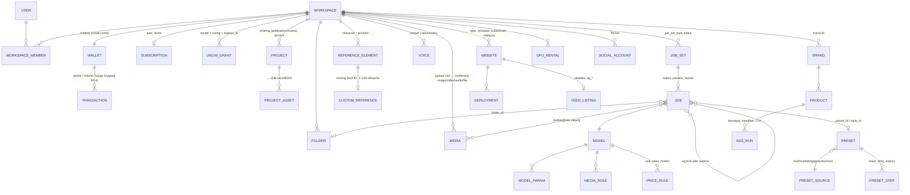

# 02 — Katalog modeli i presetów Higgsfield (first-hand, MCP read-only)

Stan na 2026-11-13. Źródło główne: podłączony serwer MCP `higgsfield_ai` na koncie założyciela (plan `ultra`), wyłącznie wywołania odczytowe. Znaczniki: **[zweryfikowane]** = wynik narzędzia MCP lub strona WWW, **[wnioskowanie]** = moja interpretacja, **[niepewne]** = brak potwierdzenia. Kody źródeł (M1…, W1…) rozwinięte w sekcji „Źródła".

## TL;DR

- Katalog generacji to **140 definicji modeli**: 60 video, 51 image, 18 3D, 11 audio; 23 nazwanych dostawców + 26 pozycji bez dostawcy (narzędzia typu upscale/remove-bg) [zweryfikowane] (M1).
- Model jest opisany **czysto jako dane**: `id, name, provider_name, description, output_type, parameters[], medias[], aspect_ratios[], tags[], supports_unlim`. **Brak pól cenowych** — cena jest liczona osobnym, niegenerującym preflightem (`get_cost: true`) [zweryfikowane] (M1, M9).
- Presety to nie jedna galeria, lecz **≥12 katalogów CMS** o różnych kontraktach: łącznie ok. **1 090 policzonych pozycji** (Marketing Studio 649, Viral 87, przepisy slash 80, What If 56, karty „micro drama" 44, AI Influencer 39, LoRA 34, Soul 33, Shorts 28, Explainer 22, style Genjutsu 20) + Genjutsu motion i Katana bez licznika [zweryfikowane] (M2–M6).
- Wieloetapowe produkty (reklamy, UGC, faceless, remix, strony WWW) są **23 wersjonowanymi „workflowami"** = instrukcja + pliki referencyjne + skrypty w sandboxie; orkiestruje je agent LLM, a nie sztywny backendowy DAG [zweryfikowane] (M7).
- Ekonomia: Ultra = 3 000 kredytów/mies. (cena katalogowa 129 USD, promocja 65 USD/mies. rocznie), paczki 500–4 000 kredytów (17–19 kr/USD, ważne 90 dni), auto-refill 20 kr/USD. Video premium kosztuje **3–12 kr/s**, obraz **0,12–11 kr** [zweryfikowane, stawki oznaczone przez samo źródło jako historyczne z 2026-10-08] (M8, M9).
- Serwer MCP wystawia **172 narzędzia** w 21 domenach — to de facto mapa backendu (projekty, foldery, workspace'y, media, joby, głosy, elementy referencyjne, Ads Studio, GPU, 3D, strony WWW, TikTok) [zweryfikowane] (M12).

## 1. Metoda i ograniczenia

Wywołano tylko: `models_explore` (list ×2, get ×4), `get_presets` (przeglądanie 9 źródeł), `get_preset_instructions` (katalog + 5 pozycji), `get_workflow_instructions` (katalog + 7 workflowów), `get_workflow_bundle_file` (8 plików), `get_explainer_presets`, `ads_studio_story_presets`, `ai_influencer_get_options`, `ai_influencer_list_presets`, `list_website_categories`, `gpu_list_gpus/models/loras`, `balance`, `show_plans_and_credits`. **Nie wywołano `get_katana_config`** — jego opis mówi, że zapisuje stan sesji, więc nie jest read-only. Nie wywołano niczego, co generuje, wycenia przez `generate_*`, uploaduje lub zmienia stan. Konsekwencja: nie mam bieżących cen per model z preflightu — tylko tabelę „historyczną" z bundla Katana.

## 2. Inwentarz modeli (140) [zweryfikowane] (M1)

| Modalność | Liczba | Uwagi |
|---|---|---|
| video | 60 | w tym 15 „Higgsfield" (Cinema Studio, Marketing Studio, Genjutsu, Ad Multiplier, Intone) i 14 narzędzi bez dostawcy |
| image | 51 | 11 „Higgsfield" (Soul, Cinema/Marketing Studio Image), 11 narzędzi bez dostawcy |
| 3d | 18 | Meshy 10, Tripo 3 (+1 bez dostawcy), Meta 2, Tencent 2 |
| audio | 11 | TTS, muzyka, SFX, dubbing |

| Dostawca (`provider_name`) | Σ | Identyfikatory (skrót) |
|---|---|---|
| Higgsfield | 27 | image: `soul_2`/`soul_v2`, `soul_cinematic`, `soul_cast`, `soul_location`, `cinematic_studio_2_5`, `marketing_studio_image`, `ms_image`, `marketing_studio_2_image`, `image_auto`, `image_command`; video: `cinematic_studio_video` (+`_v2`, `_3_0`, `_4_0`), `marketing_studio_video`, `marketing_studio_v2_video`, `…_reference2video`, `higgsfield_preset`, `ad_multiplier`, `ad_multiplier_v2`, `hf_mult_motion_control`/`_replace_object` (+`_flash`), `intone`; audio: `text2speech_v2` |
| (pusty) | 26 | `topaz_image`, `topaz_image_generative`, `topaz_video`, `bytedance_image_upscale`, `bytedance_video_upscale`, `video_upscale`, `video_deflicker`, `fps_boost`, `image_background_remover`, `video_background_remover`, `sam_3_video`, `outpaint`, `reframe`, `image_decompose`, `draw_to_video`, `sync_so` (lipsync), `voice_change`, `dubbing`, `kling3_0_motion_control`, `tripo_3d`, warianty `cinematic_studio_*` |
| Bytedance | 11 | Seedream 4.5 / 5.0 Lite / 5.0 Flash / 5.0 Pro / 5.5, `3d_jutsu_angles`; Seedance 2.0 / 2.0 Mini / 2.5 / 2.5 Flash; `seed_audio` |
| Meshy | 10 | image→3D, multi-image→3D, text→3D (v6), v7, rigging, remesh, retexture (część jako aliasy) |
| Google | 9 | Nano Banana / Pro / 2 / 2.1 / 2 Lite; Veo 3.1, Veo 3.1 Lite, Gemini Omni Flash 1.1 / 1.2 |
| Kling | 9 | `kling2_6`, `kling3_0`, `kling3_0_turbo`, `kling4_0`, `kling_4_0_flash`, `kling_o3_image_reference`, `kling_o3_flf`, `kling_video_edit`, `kling_omni_image` |
| Black Forest Labs | 6 | `flux_2`, `flux_2_pro_outpaint`, `flux_3_image`, `flux_kontext`, `flux_3_video`, `flux_3_video_edit` |
| OpenAI | 5 | `gpt_image_2`, `gpt_image_2_5`, `gpt_image_2_6` (domyślny model obrazu wg instrukcji serwera), `gpt_image_2_6_flare`, `openai_hazel` |
| ElevenLabs | 5 | `elevenlabs_v4`, `…_turbo`, `elevenlabs_music_v2`, `…_v2_5`, `audio_dubbing` |
| xAI | 5 | `grok_image`, `grok_image_2_0`, `grok_video`, `grok_video_v15`, `…_lite` |
| Wan | 4 | `wan2_6`, `wan2_7`, `wan3_0`, `wan3_0_prime` |
| MiniMax / Hailuo | 4 | `minimax_h3`, `minimax_h3_max`, `minimax_h3_image`, `minimax_hailuo` |
| FAL | 3 | `sonilo_music`, `mirelo_text_to_audio`, `inworld_text_to_speech` |
| Pozostali | 16 | Tripo 3, Ideogram 2, Recraft 2, Meta 2 (SAM 3 3D), Tencent 2 (Hunyuan3D), Alibaba (Qwen TTS), Tongyi-MAI (`z_image`), Depth Anything, Happy Horse, Topaz (`topaz_hyperion_2_5`) |

Obserwacje:
- Katalog zawiera aliasy i warstwy legacy (`soul_2`=`soul_v2`, `image_to_3d`=`meshy_image_to_3d`; plik cen ma jawną mapę `aliases`) — 140 to liczba definicji, nie unikalnych modeli [zweryfikowane] (M1, M9).
- **W katalogu MCP nie ma modelu Sora** ani Veo nowszego niż 3.1 [zweryfikowane] (M1); czy są dostępne w UI web — [niepewne]. SDK aplikacji wymienia tylko `soraEnhanceVideo` jako upscale (M10).
- `provider_name: "FAL"` przy 3 modelach audio sugeruje, że część podaży idzie przez agregator fal.ai [wnioskowanie].
- 13 modeli ma `supports_unlim: true` (m.in. `soul_2`, `nano_banana_pro`, `nano_banana_2`, `gpt_image_2_6`, `seedream_v5_pro`, `seedance_2_0`, `seedance_2_5`, `seed_audio`, `text2speech_v2`) — to modele objęte promocyjnym „unlimited" [zweryfikowane] (M1).
- Osobny katalog „GPU / open models" (`gpu_list_models`): 4 modele open-weights (`minimax-h3`, `wan-2-2-t2v-a14b`, `ltx-video`, `qwen-image`), 34 showcase LoRA i 7 typów GPU do wynajęcia [zweryfikowane] (M11).

## 3. Model jako dane — kształt definicji (pod „model registry")

### 3.1 Pola [zweryfikowane] (M1)

```ts
type ModelDef = {
  id: string; name: string; provider_name: string; description: string;
  output_type: "image" | "video" | "audio" | "3d";
  parameters: Param[]; medias: MediaSlot[];
  aspect_ratios: string[];          // [] dla audio/3D/utility
  tags: string[]; supports_unlim?: boolean;
  durations?: number[] | null;      // legacy, tylko 4 modele
  duration_range?: {min:number; max:number} | null; // legacy
};
type Param = {
  name: string; required: "required" | "optional";
  type: "string" | "number" | "bool" | "string_array" | "object_array";
  description?: string; default?: unknown; options?: (string|number)[];
  min?: number; max?: number; nullable?: boolean;
  format?: "regex"; pattern?: string;          // np. UUID dla style_id / folder_id
};
type MediaSlot = { name: string;   // "medias" w 116 modelach
  type: "image";                    // zawsze "image", także dla ról video/audio
  roles: string[]; max?: number; required?: boolean;
  description: string };            // limity per rola zapisane tekstem
```

Statystyka z 140 definicji: 591 parametrów (string 311, number 149, bool 114, string_array 10, object_array 7); 39 wymaganych; 212 z `options`; 124 z `min/max`; 334 z `default`. Najczęstsze nazwy: `resolution` 62, `duration` 39, `folder_id` 23, `mode` 22, `quality` 17, `batch_size` 15, `generate_audio` 15, `seed` 11. Role mediów: `image_references` 71, `video_references` 34, `start_image` 33, `end_image` 24, `image` 18, `audio_references` 16, `input_video` 6, `mask` 4. 116 modeli przyjmuje media, 24 są text-only. Proporcje: `16:9` 80, `9:16` 79, `1:1` 76, `3:4`/`4:3` 65, `21:9` 47, `auto` 40 [zweryfikowane] (M1).

Ważne niuanse:
- **Czas trwania jest zwykłym parametrem** `duration` (`min/max` albo `options`), a rozdzielczość to `resolution` **lub** `quality` **lub** `mode` (`std/pro/4k` u Kling 3.0) — brak ujednolicenia; własny rejestr powinien to znormalizować [wnioskowanie].
- Limity ilościowe ról (np. „max 30 obrazów łącznie") są zapisane **tekstem w `description`**, nie strukturalnie — to słabość, której nie warto kopiować [wnioskowanie].
- W wywołaniu generacji klient podaje role kanoniczne `image|video|audio|start_image|end_image|ref_element`, a serwer mapuje je na slot modelu (`adjustments.medias[i].role`) [zweryfikowane] (M9).
- Kształt żądania: `params: {model, prompt, count, aspect_ratio, resolution, duration, medias:[{value: <media_id|job_id>, role}], folder_id, get_cost?, use_unlim?}` — wyjście innego joba może być wejściem przez `job_id` [zweryfikowane] (M7, M9).

### 3.2 Cztery reprezentatywne definicje [zweryfikowane] (M1; opisy skrócone)

```jsonc
// IMAGE
{"id":"nano_banana_pro","provider_name":"Google","output_type":"image",
 "parameters":[{"name":"resolution","required":"optional","type":"string","options":["1k","2k","4k"],"default":"2k"}],
 "medias":[{"name":"medias","type":"image","roles":["image_references"],"description":"…At most 14. (array)"}],
 "aspect_ratios":["1:1","3:2","2:3","4:3","3:4","4:5","5:4","9:16","16:9","21:9"],
 "tags":["quality","text-rendering","4k","text-to-image","image-to-image","unlim"],"supports_unlim":true}

// VIDEO z referencjami
{"id":"seedance_2_5","provider_name":"Bytedance","output_type":"video",
 "parameters":[
  {"name":"mode","type":"string","options":["t2v","omni_reference","video_edit","video_extension"],"default":"t2v"},
  {"name":"duration","type":"number","min":4,"max":30,"default":5},
  {"name":"resolution","type":"string","options":["480p","720p","1080p","4k"],"default":"720p"},
  {"name":"generate_audio","type":"bool","default":true},
  {"name":"bitrate_mode","type":"string","options":["standard","high"],"default":"standard"},
  {"name":"extension_mode","type":"string","options":["backward","forward"],"nullable":true},
  {"name":"draft","type":"bool","default":false},          // szkic 480p, finalizacja do 7 dni
  {"name":"draft_job_id","type":"string","nullable":true}],
 "medias":[{"name":"medias","type":"image",
  "roles":["start_image","end_image","image_references","video_references","audio_references"],
  "description":"…image max 30 łącznie | video max 10 | audio max 10"}],
 "aspect_ratios":["auto","21:9","16:9","4:3","1:1","3:4","9:16"],"supports_unlim":true}

// AUDIO
{"id":"elevenlabs_v4","provider_name":"ElevenLabs","output_type":"audio",
 "parameters":[
  {"name":"dialogue","required":"required","type":"object_array",
   "description":"[{text, voice_type: preset|element, voice_id}] — do 10 głosów, 10 000 znaków"},
  {"name":"stability","type":"number","min":0,"max":1,"nullable":true},
  {"name":"similarity_boost","type":"number","min":0,"max":1,"nullable":true},
  {"name":"batch_size","type":"number","min":1,"max":4,"default":1}],
 "medias":[],"aspect_ratios":[]}

// UTILITY (upscale)
{"id":"topaz_image","provider_name":"","description":"","output_type":"image",
 "parameters":[
  {"name":"output_width","required":"required","type":"number","min":1},
  {"name":"output_height","required":"required","type":"number","min":1},
  {"name":"variant","type":"string","options":["Standard V2","Low Resolution V2","CGI","High Fidelity V2","Text Refine"],"default":"Standard V2"},
  {"name":"face_enhancement","type":"bool","default":false},
  {"name":"sharpen","type":"number","min":0,"max":1,"default":0},
  {"name":"denoise","type":"number","min":0,"max":1,"default":0},
  {"name":"folder_id","type":"string","nullable":true}],
 "medias":[{"name":"medias","type":"image","roles":["image_references"],"description":"…exactly one (max 1)"}],
 "aspect_ratios":[],"tags":[]}
```

Modele „studyjne" Higgsfield to ten sam kształt z dodatkowymi parametrami-identyfikatorami do własnych słowników: `cinematic_studio_video_4_0` ma `era_id, camera_model_id, camera_lens_id, camera_aperture_id, pacing_id, genre_id, light_id, color_palette`; `marketing_studio_v2_video` ma `brand_url, product_ids, avatar_id, ad_reference_id, hook/setting, device`; Kling 4.0 ma `kling_element_ids` [zweryfikowane] (M1). Czyli „studio" = model bazowy + słowniki presetów sterujących promptem [wnioskowanie].

### 3.3 Cennik jako osobne dane [zweryfikowane] (M9)

Bundel Katana zawiera `prices.json` o kształcie wartym naśladowania: `{kind, unit: "second"|"image"|"job"|"take"|"chars", rates: {"720p":7} | {"high/2k":2.75} | {"*":1}, min_s, max_s, allowed_s[], seconds: "ceil"|"round"|"exact", default_res, fixed_input (rozliczenie wg długości wejścia), modes:{…nadpisania stawek}, per_chars}`.

## 4. Presety i galerie — taksonomia

| Źródło (`source` / narzędzie) | Liczba | `kind`/`type` | Co to jest (ogólnie) | Wejście |
|---|---|---|---|---|
| `viral` (Viral Hub) | 87 | `kind: chain` | efekt video jako łańcuch kroków | 1 obraz + opcjonalny prompt + wybory |
| `marketing_studio` → `product-shot` | 418 | `product_shots`, `product_shots_people` | szablon zdjęcia produktowego | obraz produktu + prompt |
| `marketing_studio` → `motion` | 231 | `hypermotion`, `mixed_media`, `2d_motion`, `saas_motion` | szablon animacji/motion design | obraz produktu + prompt |
| `genjutsu` (+`-trending`, `-new`) | brak licznika | `genjutsu-motion` | video sterujące: transfer ruchu / podmiana obiektu | obraz(y) referencyjne lub character sheet |
| `genjutsu-styles` | 20 | `genjutsu-style` | restyle własnego video (4–30 s) | video + do 5 obrazów + prompt |
| `soul` | 33 | `soul-style` | styl obrazu = `style_id` modelu `soul_2` | tekst (+ `soul_id`) |
| `recraft` | 0 (osobiste) | — | własne zapisane style użytkownika | `style_id` |
| `katana` | brak licznika | filtr `higgsfield`/`community`; kategorie `personalized_edits`, `style_transfer`, `motion_transfer` | referencyjny montaż do remiksu | media użytkownika |
| `what_if` | 56 | styl | wygląd serii „what if" | temat/prompt |
| `shorts_studio` | 28 | preset | styl krótkiego filmu z prowadzącym | temat/skrypt |
| `get_explainer_presets` | 22 | — | styl explainera (9:16) → `media_id` referencji stylu | — |
| `get_preset_instructions` (przepisy slash) | 80 | recipe | zablokowany model + parametry + master prompt | 1 obraz |
| `ads_studio_story_presets` | 8 stylów / 44 karty | — | szkielet fabularny reklamy 40–240 s, 9:16 | produkt |
| `ai_influencer_list_presets` | 39 | — | zapisane ustawienia „character sheet" | — |
| `gpu_list_loras` | 34 showcase | — | LoRA: `base_model_id`, `trigger_word`, `default_strength` | — |

Łącznie 736 pozycji w feedzie domyślnym (viral 87 + marketing 649) [zweryfikowane] (M2). Wspólny rekord listy: `{id, name, description?, kind|type, thumbnail_url, preview_url, preview_type: image|video}`, paginacja `next_cursor` + `total`, `categories[{slug,name}]` [zweryfikowane] (M2).

### 4.1 Kształty `input_schema` [zweryfikowane] (M3)

**(a) Preset „chain" (Viral)** — JSON Schema z pięcioma grupami i kluczami `<uuid kroku>_<nazwa slotu>`:

```jsonc
{"type":"object","properties":{
  "media":{"x-media-group":true,"properties":{
     "<stepUuid>_input_images":{"type":"array","minItems":1,"maxItems":1,
        "items":{"anyOf":[{"type":"string","format":"uuid"},
          {"type":"object","properties":{"id":{"format":"uuid"},"type":{"enum":["media_input","image_job"]}}}],"x-media":"image"}}},
     "required":["<stepUuid>_input_images"]},
  "slot_selections":{},                         // wybór wbudowanych mediów presetu
  "slot_values":{"properties":{"<stepUuid>_user_prompt":{"type":"string","maxLength":60000}}},
  "choice_values":{"properties":{
     "<stepUuid>.resolution":{"enum":["480p","720p","1080p","4k"],"default":"720p"},
     "<stepUuid>.aspect_ratio":{"enum":["auto","21:9","16:9","4:3","1:1","3:4","9:16"],"default":"9:16"}}},
  "config":{}},
 "x-slot-rules":[{"slot":"…_input_images","media_path":"media.…","required":true,"allow_upload":true}]}
```

Enumy `choice_values` pokrywają się 1:1 z definicją Seedance 2.5 → preset to graf kroków, a ustawienia kroku są wystawione użytkownikowi [wnioskowanie].

**(b) Szablon Marketing Studio** (product-shot i motion identycznie): `{product_media_id: string (x-media:image, required), prompt?: string ≤5000}`.

**(c) Przepis slash** (np. packshot produktu): nie schema, lecz dokument `{id, title, description, output_type}` + blok „Generation parameters" `{"model":"gpt_image_2_6","aspect_ratio":"3:4","resolution":"2k","quality":"high"}` + stały master prompt; wejście = 1 obraz w roli `image`.

**(d) AI Influencer**: 18 grup cech (`gender`, `body_type`, `hair`, `hair_colour`, `aesthetic`, `ethnicity_origin_base`, `age`, `skin_tone`, `height`, `proportions`, `freak_head`, `freak_neck`, `eye_shape`, `eye_color`, `freak_face`, `facial_hair`, `distinctive`, `accessory`), każda `{id,label,max, options[{id,label,tiers[],slot}]}`; 9 „tierów" (`normal, freak, total` + 6 zwierzęcych). Preset zapisuje `recreate: {job_set_type:"ai_influencer_sheet", params:{tier, selection:{grupa:[id]}, brief, seed, medias}}` [zweryfikowane] (M5).

Wykonanie: detal presetu zwraca `execution.available`, `execution.readiness`, `execution.cost_credits`; start przez osobne `execute_preset` [zweryfikowane z opisów narzędzi] (M2, M3).

## 5. Workflowy — jak orkiestrowane są pipeline'y

Katalog: 23 pozycje (`ad-multiplier`, `ads-studio`, `brand-asset-creation`, `character-sheet`, `color-grade`, `creator-dub`, `creature-sculpt`, `drama-ads`, `faceless-video`, `grade-hf`, `katana`, `lighting-hf`, `manga-engine`, `narration`, `photo-to-3d-model`, `product-photoshoot`, `reel-effects`, `shorts-studio`, `thumbnail-generation`, `ugc-video`, `video-editing`, `video-montage`, `website-builder-flow`). Każdy to `SKILL.md` (zwykle z numerem wersji) + `references/*.md` + `scripts/*` (Python/JS/bash preinstalowane w zdalnym sandboxie E2B) + opcjonalny `ui.yaml` (`display_name, sub_title, category, color, example_prompts`) [zweryfikowane] (M7).

Wzorzec wspólny [zweryfikowane] (M7, M9):
1. **Agent LLM jest orkiestratorem**; workflow definiuje fazy z „bramkami", zablokowane modele („never substitute") i limity ponowień (zwykle 1 retry na pozycję).
2. **Generacja**: pojedyncze `generate_*` albo batch do 12 pozycji `{index, params}`; oczekiwanie `jobs_wait` (≤12 jobów, timeout ≤15 s, `poll_after_seconds`).
3. **Deterministyczna obróbka** (ffprobe/ffmpeg, montaż, napisy, QC) wyłącznie w sandboxie; wynik wraca przez `media_upload` (rezerwacja slotu) → PUT → `media_confirm`.
4. **Budżet**: wycena `get_cost` przed płatnym jobem, twardy limit, „canary" na rodzinę jobów, rejestr job_id (ledger), uzgadnianie z `transactions`.

| Workflow | Kroki (streszczenie) |
|---|---|
| `ad-multiplier` — Edit | intake → rejestracja i `ffprobe` źródła (4–30 s) + `video_analysis` → plan N wyjść (pary po pozycji, nigdy iloczyn kartezjański) → brakujące osoby generowane w `soul_2` i akceptowane przez użytkownika → 1 prompt/wyjście z manifestem `@Video1/@ImageN` i walidacją (≤3 900 znaków) → cichy `video_edit` modelem `ad_multiplier` (`duration = ceil(źródła)`) → sandbox: przywrócenie oryginalnego audio, bramki QC, upload |
| `ad-multiplier` — Recreate | jeden job `ad_multiplier_v2`: backend sam analizuje źródło, pisze prompt, renderuje i przywraca audio; tryb `sections` (`hook`/`cta`/`both`) rezerwuje maksimum i zwraca niewykorzystane sekundy |
| `ugc-video` | 6 formatów (review, product, unboxing, try-on, tutorial, website) → skrypt planowania długości → „boardy": GPT Image 2.6 → czyszczenie Seedream 5.5 → inspekcja → klipy Seedance 2.5 `omni_reference` z natywnym audio → inspekcja ciągłości → montaż/napisy przez `video-montage` |
| `faceless-video` | fazy 0–9: intake → kotwica stylu → roster assetów (postacie/lokacje/rekwizyty) → skrypt + plan bloków 10 s → batch klipów → lektor (workflow `narration`) → master w sandboxie → napisy → miniatura → dostawa; modele zablokowane per rola (assety `seedream_5_5`, klipy `minimax_h3`, lektor `text2speech_v2`, podkład `sonilo_music`); walidatory jako skrypty |
| `katana` | pełna analiza referencji klatka po klatce + mapa „energii" → kontrakt zadania JSON → plan kreatywny i routing ujęć → ledger z limitem → stille (keyframe-first, osobne „location plates") → klipy Seedance 2.5 → kompozycja wg EDL (silnik JS, biblioteka SFX, fonty OFL) → QA → dostawa; linia `RESUME` + archiwum stanu do wznowienia w nowym czacie |
| `ads-studio` | research marki ze strony (5 etapów: gather, synthesis, enrichment, products, assets) lub sam produkt → `quote` → jawna zgoda na cenę → `generate` z `idempotency_key`, `total`, `aspect_ratio`, `objective` → „run" z konceptami `{headline, primary_text, cta, destination_url}` |
| `character-sheet` | architektura slotów promptu (kompozycja → tożsamość → twarz → … → negative tail), 5 presetów stylu × 5 kompozycji, opcjonalne `generate_image` 16:9 |
| `website-builder-flow` | 3 typy: `website` (niezależna marka), `app` (logowanie Higgsfield + SDK generacji + design system), `game`; jeden Cloudflare Worker na stronę (React 19 + TanStack Start SSR, bun), infrastruktura deklarowana w manifeście (D1/R2/KV/Durable Object/kontener); website: brief → boardy sekcji jako obrazy → kit assetów → build → motion → bramka grep → deploy; okładka + metadane obowiązkowe; publikacja do feedu społeczności osobnym krokiem |

Dla aplikacji typu `app` dokumentacja SDK ujawnia **wewnętrzne REST API** (`https://fnf.internal`) [zweryfikowane] (M10): `POST /jobs/submit`, `POST /jobs/cost`, `POST /jobs/{id}/cancel`, `POST /jobs/media/presign`, `POST /jobs/media/{id}/confirm`, `GET /jobs/{id}`, `GET /jobs/sets/{id}`, `GET /jobs?gen_type=&size=`, `GET /reference-elements`, `POST /custom-references` (trening postaci: typy `soul|soul_2|soul_cinematic`, 1–100 obrazów), `POST /realtime/chain/{edit,cost,finalize}`, CRUD `/realtime/custom-styles`, `GET /user`, `GET /workspaces`, `/workspaces/current`, `/workspaces/wallet`, `POST /workspaces/switch`, bramka LLM `/llm`. Trzy szablony UI aplikacji: `studio` (sidebar projektów + dock promptu + feed), `preset` (galeria stylów + panel tworzenia + historia), `app-detail` (landing jednego narzędzia). Wymagana „bramka potwierdzenia" przed submitem (modal: model + ustawienia + koszt → `confirmation_token`).

## 6. Plany, kredyty, koszty

### 6.1 Co pokazuje widżet cennika (konto Ultra) [zweryfikowane] (M8)

- Widoczny tylko plan **ULTRA**: 3 000 kredytów/mies.; cena katalogowa 12 900 centów, cena końcowa 6 500 centów/mies. przy rozliczeniu rocznym (promocja `sale_11_11`, do −60%). Okresy: monthly, annual, eighteen_month, two_year.
- Funkcje Ultra: równolegle do **8 video + 8 obrazów**, wszystkie modele, wczesny dostęp, tańsze doładowania; blok „Supercomputer" (5 GB storage, do 10 zaplanowanych zadań); pakiety „365-day unlimited" na starsze modele obrazu i „7-day unlimited" na nowe.
- **Top-upy** (jednorazowe, ważne 90 dni): 500 kr = 29,41 USD; 1 000 = 55,56; 2 000 = 105,26; 4 000 = 210,53 (17–19 kr/USD; ceny przekreślone 42,50–340 USD).
- **Auto-refill**: próg 300 kr; opcje 20/40/90/150/300 USD → 400/800/1 800/3 000/6 000 kr (20 kr/USD), ważność 90 dni.
- Silnik promocji jako dane: lista `datetime_settings[{source, starts_at, ends_at, params}]` (np. premiera modelu, darmowe generacje, przedsprzedaż); pozycja `freegen_card_bonus`: 40 kr, ważność 90 dni (bonus za podpięcie karty — [wnioskowanie] z nazwy).
- Workspace: `individual | team_owner | team_member`; portfel w „credit-cents" (÷100 do wyświetlenia) (M10).

Drabina publiczna (źródła wtórne, sprzeczne): najczęściej Starter 19 USD / 270 kr, Plus 59 USD (47 rocznie) / 1 200 kr, Ultra 129 USD (99 rocznie) / 3 000 kr; inne źródła podają Basic 9 / Pro 29 / Max 79 USD ([Krea](https://www.krea.ai/blog/higgsfield-pricing-explained-2026-unlimited-credits-and-real-monthly-costs), [HeyGen](https://www.heygen.com/blog/higgsfield-pricing), [AI Eating the World](https://www.aieatingtheworld.com/articles/higgsfield-ai-pricing)) [niepewne — tylko Ultra 129 USD / 3 000 kr potwierdza MCP].

Wartość kredytu [wnioskowanie z liczb powyżej]: ~0,043 USD (Ultra katalogowo), ~0,022 USD (promocja), 0,050–0,059 USD (top-up/auto-refill).

### 6.2 Koszty per generacja [zweryfikowane jako zapis w `prices.json`; samo źródło oznacza je „historical 2026-10-08", część „verified live"] (M9)

| Model | Jednostka | Stawka (kredyty) |
|---|---|---|
| `seedance_2_5`, `ad_multiplier`, `cinematic_studio_video_4_0` | /s | 480p 3 · 720p 7 · 1080p 12 (10 s 720p = 70 kr, potwierdzone live) |
| `seedance_2_0` | /s | 3 · 4,5 · 9 · 4k 22; tryb fast 1 / 2,5 |
| `hf_mult_*` (Genjutsu) | /s wejścia | 3 · 7 · 11, min. 4 s |
| `kling3_0` | /s | std 1,75 · pro 2 · 4k 6 |
| `veo3_1` / `veo3_1_lite` | /s | fast 4 · preview 10 / 1,5 |
| `wan3_0`, `minimax_h3`, `happy_horse_video` | /s | 1–3,5 / 2 / 2,5–4,5 |
| `soul_2`, `z_image` | /obraz | 0,12 / 0,15 |
| `nano_banana_2(_1)` / `nano_banana_pro` | /obraz | 1k 1,5 · 2k 2 · 4k 3 / 2 · 2 · 4 |
| `gpt_image_2` / `gpt_image_2_5` | /obraz | low 0,5 → high/4k 11 / low/1k 0,25 → max/1k 5 |
| `seedream_v5_pro`, `flux_2` | /obraz | 1,25–2,5 / pro 1–1,5, max 4–6 |
| remove background, image upscale | /job | 1 / 2 |
| `elevenlabs_v4` / turbo | /30 znaków | 0,23 / 0,15 |
| `sonilo_music`, `mirelo_text_to_audio` | /s | 0,0625 / 0,25 |
| GPU (L40S → B300) | /GPU-h | 71 · 98 · 120 · 134 · 176 · 197; open model 34 kr/generację (M11) |

Spójność z marketingiem planu: „3 000 kr ≈ 1 500 generacji Nano Banana Pro ≈ 500 video Kling 3.0" ⇒ 2 kr/obraz i ~6 kr/klip [zweryfikowane] (M8). Przykład: klip Seedance 2.5 10 s 720p ≈ 3,0 USD po cenie Ultra, 3,7–4,1 USD z top-upu [wnioskowanie].

Rozliczenia [zweryfikowane] (M9): debet w chwili submitu; statusy jobów `pending → in_progress → completed | failed | nsfw | ip_detected` (+ `canceled`); dla trzech porażek zaobserwowano automatyczny zwrot po 5 s–4 min; `transactions` ma `{display_name, credits, action: spend|refund, created_at}` **bez job_id**. Wg źródeł wtórnych (W1–W3) kredyty subskrypcyjne nie przechodzą na kolejny okres [niepewne — MCP potwierdza tylko 90-dniową ważność top-upów i auto-refill].

## 7. Narzędzia MCP wg domen (172) i model encji

| Domena | # | Narzędzia |
|---|---|---|
| Generacja | 7 | `generate_{image,video,audio}` + `_batch`, `generate_3d` |
| Edycja assetów | 6 | `upscale_image`, `upscale_video`, `outpaint_image`, `reframe`, `remove_background`, `motion_control` |
| Katalog modeli | 1 | `models_explore` |
| Joby / wyniki | 5 | `jobs_wait`, `job_display`, `show_generations`, `show_generation_by_ids`, `show_result` |
| Media | 5 | `media_upload`, `media_upload_widget`, `media_confirm`, `media_import_url`, `show_medias` |
| Presety | 10 | `get_presets`, `get_preset_instructions`, `execute_preset`, `get_explainer_presets`, `resolve_explainer_preset`, `get_katana_config`, `register_katana_result`, `show_katana_result`, `register_result`, `register_what_if_result` |
| Workflowy / sandbox | 3 | `get_workflow_instructions`, `get_workflow_bundle_file`, `sandbox_exec` |
| Projekty | 25 | `create/get/list/update/delete/archive/unarchive_project`, assety (`attach, copy, move, remove, list, resolve, get_…_prompt, get_…_source`), sharing (`share, get/update_…_sharing`), publikacja (`publish, unpublish, get/update_…_publication, save_…_preview, confirm/cancel_…_review`) |
| Foldery | 7 | `create, get, list, search, move, rename, delete_folder` |
| Workspace / preferencje | 4 | `list_workspaces`, `select_workspace`, `get_preferences`, `update_preferences` |
| Billing | 4 | `balance`, `transactions`, `show_plans_and_credits`, `cancel_trial_auto_renewal` |
| Głosy / audio | 5 | `list_voices`, `create_voice`, `create_voice_from_confirmed_audio`, `voice_change`, `dubbing` |
| Postacie / referencje | 3 | `show_characters`, `show_reference_elements`, `manage_reference_elements` |
| AI Influencer | 6 | `ai_influencer_{get_options, list_presets, get_settings, prepare, generate}`, `build_ai_influencer` |
| Ads Studio | 16 | marki, produkty, awatary, `quote`, `generate`, runy, `story_{presets, recipe, stage}` |
| Marketing Studio | 2 | `show_marketing_studio_v2`, `show_marketing_studio_generations` |
| Analiza video | 4 | `video_analysis_{create, status, jobs}`, `virality_predictor` |
| TikTok | 7 | `tiktok_{accounts, connect, reconnect, prepare_publish, publish_status, music_trending, music_tune}` |
| Strony / aplikacje / gry | 16 | `create/deploy/publish/rename_website`, `list_websites`, `list_website_categories`, `website_{db, repo_access, secrets, status}`, `apps_{search, describe, invoke}`, `publish_playable_game`, `get_playable_game_publication`, `participate_in_contest` |
| GPU / open models | 19 | `gpu_{list_gpus, list_models, list_loras, lora_import, private_models, explore, my, generate, job_quote, job_start, job_status, job_cancel, rent, rental, rental_prepare, rental_exec, rental_generate, rental_logs, rental_stop}` |
| 3D | 17 | 16× `scene_builder_3d_*` (projekt, operacje Python/Blender, GLB/.blend, kąty, video) + `animation_actions` |

Listing zewnętrzny podaje „140 tools" ([Gumloop](https://www.gumloop.com/connectors/higgsfield-mcp)); w tej sesji naliczono 172 nazwy — rozbieżność wynika zapewne z daty/profilu konektora [niepewne].

### Szkic ER [wnioskowanie z nazw narzędzi, schematów i dokumentacji SDK]



## 8. Wnioski dla planu budowy

1. **Rejestr modeli jako dane** (tabele `models`, `model_params`, `model_media_roles`, `price_rules` albo JSONB) i **jeden generyczny endpoint** `POST /jobs` z `{model, prompt, params, medias[{role,value}]}`; formularz UI generowany z definicji. To jest dokładnie architektura Higgsfield [zweryfikowane] (M1, M10).
2. Popraw ich słabości: ujednolić `resolution/quality/mode`, trzymać limity ról strukturalnie (`max` per rola), a `job_id` zapisywać w transakcjach [wnioskowanie].
3. **Trzy typy presetów wystarczą na start**: (a) „recipe" = model + parametry + master prompt + 1 obraz; (b) „style" = `style_id`/obraz referencyjny; (c) „chain" = kroki ze slotami i `input_schema` (JSON Schema + rozszerzenie `x-media`). Presety w CMS (tabela + storage podglądów), nie w kodzie.
4. **Preflight kosztu + rezerwacja + auto-zwrot** przy `failed/nsfw/ip_detected`, `idempotency_key` na submit, limit równoległości per plan (wzorzec: 8+8 na najwyższym planie).
5. **Upload**: presign → PUT → confirm; media i wyniki jobów adresowane wspólnie (typ `media_input` vs `*_job`).
6. **MVP ≠ 140 modeli**: realnie 10–15 modeli przez agregator (obraz: 3–4, video: 4–5 z rolami start/end/reference, audio: TTS + muzyka, utility: upscale + remove-bg). Modele własne Higgsfield (Soul, Cinema Studio, Genjutsu, Intone) wymagają zamienników.
7. Workflowy agentowe (UGC, faceless, remix, website builder) to faza 2+: wymagają sandboxu z ffmpeg, biblioteki walidatorów i agenta LLM; na start jeden deterministyczny pipeline (np. zdjęcie produktu → klip → napisy).
8. Portfel: kredyty subskrypcyjne bez rollover + top-upy z datą wygaśnięcia + auto-refill z progiem + osobne „granty unlimited" per model/konfiguracja.

**Ryzyka:** migawka z jednego konta i jednego dnia (katalog zmienia się co tydzień); stawki per generacja są historyczne i nie pochodzą z preflightu; marże na video premium (3–12 kr/s) są cienkie, a „unlimited" działa jak loss-leader [wnioskowanie]; treść `SKILL.md`, master promptów i nazwy presetów to własność Higgsfield — tu wykorzystane wyłącznie jako dowód architektury, nie do kopiowania; moderacja (`nsfw`, `ip_detected`) i klonowanie głosu/tożsamości wymagają własnych zabezpieczeń.

## Źródła

Narzędzia MCP `higgsfield_ai` (wywołania 2026-11-13, konto założyciela):
- **M1** `models_explore` — `list` (2 strony, 100 + 40), `get` dla `nano_banana_pro`, `seedance_2_5`, `elevenlabs_v4`, `topaz_image`.
- **M2** `get_presets` — feed domyślny, `viral`, `marketing_studio` (`product-shot`, `motion`), `genjutsu`, `genjutsu-styles`, `soul`, `recraft`, `katana`, `what_if`, `shorts_studio`.
- **M3** `get_preset_instructions` — katalog (80 przepisów), przepis packshot, preset Viral, 2 presety Marketing Studio, `/genjutsu`.
- **M4** `get_explainer_presets`; **M5** `ai_influencer_get_options`, `ai_influencer_list_presets`; **M6** `ads_studio_story_presets`, `list_website_categories`.
- **M7** `get_workflow_instructions` — katalog + `character-sheet`, `website-builder-flow`, `ad-multiplier`, `faceless-video`, `ugc-video`, `ads-studio`, `katana`; `get_workflow_bundle_file`: `ad-multiplier/references/recreate.md`, `ad-multiplier/ui.yaml`, `website-builder-flow/references/{website-flow,app-flow,app-layouts}.md`.
- **M8** `show_plans_and_credits`, `balance`.
- **M9** `get_workflow_bundle_file`: `katana/scripts/prices.json`, `katana/references/mcp-api.md`, `katana/references/budget.md`.
- **M10** `get_workflow_bundle_file`: `website-builder-flow/references/fnf-sdk.md`.
- **M11** `gpu_list_gpus`, `gpu_list_models`, `gpu_list_loras`.
- **M12** lista 172 nazw narzędzi konektora widoczna w sesji.

WWW (wtórne, tylko kontekst cennika publicznego):
- **W1** [Krea — Higgsfield Pricing 2026](https://www.krea.ai/blog/higgsfield-pricing-explained-2026-unlimited-credits-and-real-monthly-costs)
- **W2** [HeyGen — Higgsfield Pricing 2026](https://www.heygen.com/blog/higgsfield-pricing)
- **W3** [AI Eating the World — Higgsfield AI Pricing (October 2026)](https://www.aieatingtheworld.com/articles/higgsfield-ai-pricing)
- **W4** [Gumloop — Higgsfield MCP connector](https://www.gumloop.com/connectors/higgsfield-mcp)
