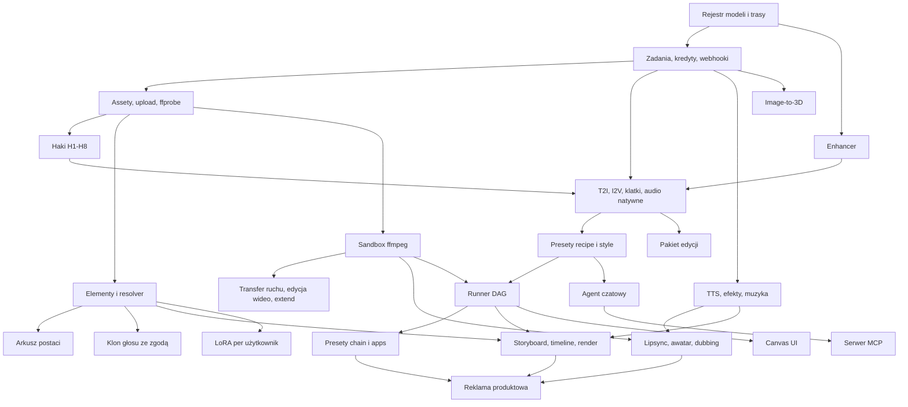

# 09 - Receptury funkcji i pipeline'y (stan na 2026-11-13)

**Metoda i ograniczenia.** Wspólny limit WebSearch był wyczerpany przed moim pierwszym zapytaniem (0 udanych wyszukiwań), a WebFetch blokuje polityka sieci (nie rozwiązuje się m.in. `fal.ai`). Źródła odczytane dziś na żywo: katalog Vercel AI Gateway przez MCP (operacje, limity wejść i ceny modeli), dokumentacja Vercel i Supabase przez MCP, opisy narzędzi konektora MCP Higgsfield widoczne w sesji (nie wywołałem żadnego narzędzia Higgsfield), dołączona referencja Claude API (migawka 2026-11-03) oraz raporty równoległe 02, 03, 05, 06.

Tagi: **[zweryfikowane]** = źródło odczytane dziś albo fakt ze źródłem w raporcie równoległym (oznaczenie R02, R03, R05, R06); **[wnioskowanie]** = mój projekt lub rachunek; **[niepewne]** = wiedza modelu sprzed połowy 2026 bez dzisiejszego potwierdzenia. Dotyczy to zwłaszcza identyfikatorów endpointów fal.ai i narzędzi niszowych; przed implementacją trzeba je sprawdzić u źródła.

## Weryfikacja na żywo (2026-11-13)

Drugi przebieg: katalog AI Gateway i dokumentacja Vercel/Supabase przez MCP oraz wyszukiwanie WebSearch (budżet 24 zapytań wspólny z R05). Większość cen fal pochodzi ze stron modeli fal (`fal.ai/models/...`) w wynikach wyszukiwania, bez otwierania stron (WebFetch zablokowany), więc przed budżetowaniem potwierdzić na `fal.ai/pricing`.

**Potwierdzone:**
- Kling 4.0 i Seedream 5.5 **nie ma w katalogu AI Gateway** (najnowsze: `klingai/kling-v3.0-*`, `bytedance/seedream-5.0-pro`); Seedance 2.5 jest, z ceną za tokeny wideo (10,7 USD/1M tokenów dla 480p i 720p, 11,7 dla 1080p; z wejściem wideo 6,4 / 7,0), nie za sekundę [zweryfikowane: katalog MCP].
- Kolejka fal: brak dedykowanego klucza idempotencji przy submit; webhooki mogą być ponawiane, więc deduplikacja po `request_id` i szybkie 200; wynik w kolejce trzymany 1 h; pliki wyników publiczne i wygasają wg ustawień (`X-Fal-Object-Lifecycle-Preference`); `X-Fal-No-Retry: 1` wyłącza ponowienia po błędzie runnera ([queue][fal-queue], [webhooki][fal-webhooks]).
- Endpointy fal z cenami: lipsync, awatary, video-to-audio, interpolacja, relight, usuwanie tła wideo, reframe obrazu, trening LoRA (tabele w sekcjach 3, 6, 7, 8).
- ElevenLabs Scribe v2 zwraca znaczniki czasu słów (`timestamps_granularity="word"`, także `character`) i diaryzację ([docs][el-stt]).
- Supabase OAuth 2.1 Server: beta, bezpłatny w becie na wszystkich planach ([docs][sb-oauth]).

**Skorygowane:** Kling 4.0 na fal kosztuje wg źródła wtórnego ok. $0.157/s (720p) i $0.235/s (1080p, domyślna rozdzielczość fal), z natywnym audio ([porównanie][kling4-fal]); ceny Seedance 2.5 w AI Gateway są tokenowe (sekcja 0).

**Nadal otwarte:** Seedream 5.5 i Seedance 2.5 na fal (ceny nie znalezione; Seedream 5.5 u Segmind $0.021-0.037 za obraz [segmind-s55]); dedykowany endpoint reframe wideo na fal; warunki ElevenLabs dla osadzania TTS, klonowania i dubbingu w produkcie sprzedawanym użytkownikom (znalazłem tylko streszczenia wtórne); harmonogram ponowień webhooków fal; billing nieudanych generacji w AI Gateway.

## TL;DR

- **Większość "magii" to dziś jedno wywołanie modelu wielozadaniowego.** Seedance 2.5, Kling 3.0, Wan 3.0, MiniMax H3 i Veo 3.1 mają w jednym API: image-to-video, pierwszą i ostatnią klatkę, referencje, natywne audio, a część także edycję wideo i przedłużanie [zweryfikowane][gw]. Budować trzeba 5 abstrakcji, nie 13 funkcji.
- **Enhancer promptów** to jedno wywołanie Claude ze structured output; przewodniki per model i słowniki kamery leżą w bazie. Koszt ok. $0.02 na `claude-opus-5-5`, czyli 1-4% kosztu klipu, ale 15-60% kosztu obrazu [wnioskowanie].
- **Presety** mają trzy rodzaje (recipe, style, chain) w jednym schemacie JSON. Preset chain, "app" i graf z canvasu to ten sam obiekt wykonywany przez jeden runner DAG [wnioskowanie].
- **Tożsamość postaci:** zacząć od referencji i arkusza postaci (bez treningu); LoRA per użytkownik (ok. $2 za trening [zweryfikowane: R03]) dopiero w fazie 2, bo działa tylko na modelach z otwartymi wagami.
- **Transfer ruchu i edycja wideo** są dostępne przez API: Kling 3.0 Motion Control $0.126-0.168/s, Seedance 2.5 z wejściem wideo ok. $0.138/s w 720p [zweryfikowane][gw].
- **Audio:** TTS, efekty i muzyka ElevenLabs idą przez AI Gateway jednym wywołaniem `generateSpeech` [zweryfikowane][gw-tts]; lipsync, dubbing i klonowanie głosu wymagają fal albo API bezpośrednich.
- **Montaż:** timeline JSON jako źródło prawdy, ffmpeg w Vercel Sandbox na start, Remotion dla szablonów [zweryfikowane: R05].
- **Agent:** ok. 12 narzędzi wysokiego poziomu, wycena przed generacją i zgoda egzekwowana na serwerze; ten sam moduł narzędzi wystawiony jako serwer MCP (`mcp-handler` + Supabase OAuth 2.1) [zweryfikowane][mcp-vercel][sb-mcp].

## 0. Macierz zdolności modeli wideo

Odczyt katalogu AI Gateway z 2026-11-13 [zweryfikowane][gw]. Ceny listowe za sekundę; fal bywa tańszy lub droższy (np. Kling 3.0 na fal $0.084-0.168/s [zweryfikowane: R03]).

| Model (ID w AI Gateway) | Operacje | Czas | Audio | Limity referencji | Cena/s |
|---|---|---|---|---|---|
| `klingai/kling-v3.0-i2v` / `-t2v` | I2V, first-last-frame, reference-to-video, multi-shot | 3-15 s | tak | 3 obrazy (jpg/png, do 10 MB); prompt do 2500 znaków | $0.168-0.392 |
| `klingai/kling-v3.0-motion-control` | transfer ruchu | 3-30 s | nie | 1 obraz + 1 wideo (3-30 s, do 100 MB) | $0.126 / $0.168 |
| `bytedance/seedance-2.5` | T2V, I2V, FLF, referencje, edycja wideo, extend | 4-30 s | tak | 30 obrazów, 10 wideo (2-30 s), audio 2-30 s; tylko URL | $0.103 / $0.231 / $0.569 (480/720/1080p, przeliczenie); katalog 13.11.2026 podaje cenę tokenową: $10.7/1M tokenów (480p, 720p), $11.7 (1080p), z wejściem wideo $6.4 / $7.0, z minimalną liczbą tokenów zależną od długości [zweryfikowane][gw] |
| `google/veo-3.1-generate-001` (+Fast, Lite) | T2V, I2V, FLF, referencje, extend | 4, 6, 8 s | tak | 3 obrazy; tylko 16:9 i 9:16 | $0.20 / $0.40 z audio; Fast $0.10 / $0.15 |
| `alibaba/wan-v3.0-video` | T2V, I2V, FLF, referencje (obraz, wideo, audio) | 2-30 s | tak | 10 obrazów, 5 wideo (1-15 s), audio 1-15 s; prompt do 20 000 znaków | $0.05 / $0.10 / $0.20 |
| `minimax/minimax-h3` | T2V, I2V, FLF, referencje | 4-15 s | tak | 9 obrazów, 3 wideo, audio 2-15 s | $0.08 (768p), $0.13 (2K) |
| `bfl/flux-3-video` | T2V, I2V, FLF, extend | 5-20 s | tak | 10 obrazów, 1 wideo | brak w katalogu |
| `heygen/heygen-video-1` | T2V, I2V, referencje; zsynchronizowany dialog | 5-15 s | tak | 9 obrazów, 3 wideo (do 5 s) | $0.01-0.05; referencje $0.035-0.09 |

Kling 4.0 jest na fal, ale nie w AI Gateway (katalog 13.11.2026 [zweryfikowane][gw]). Na fal ok. $0.157/s w 720p i $0.235/s w 1080p; fal domyślnie generuje 1080p, więc bez jawnego `resolution` 30 s kosztuje $7.05 zamiast $4.71; natywne audio w cenie; referencje wideo droższe [zweryfikowane wtórnie][kling4-fal]. Kling 4.0 Flash: nie znalazłem ceny [niepewne]. Pozostałe parametry Kling 4.0 (czasy, limity referencji) nie sprawdzone.

**Latencja.** Katalog nie podaje latencji (pola puste). Dokumentacja zaleca timeout pollingu co najmniej 600 000 ms i mówi o "kilku minutach" na wideo [zweryfikowane][gw-t2v]. Wartości orientacyjne dla całego raportu [niepewne]: obraz 5-40 s; klip wideo 1-5 min; TTS 1-5 s; muzyka 10-60 s; lipsync i upscale wideo kilka razy dłużej niż trwa materiał; trening LoRA 2-30 min; 3D 0,5-5 min. Przed ustawieniem timeoutów zmierzyć na własnym ruchu.

## 1. Enhancer promptów ("reżyser")

**Użytkownik widzi:** przełącznik "Ulepsz prompt", podgląd wersji przepisanej z edycją i cofnięciem, chipy słownika (ruch kamery, obiektyw, światło). Pisze po polsku, model dostaje angielski; kwestie dialogowe zostają w języku oryginału.

**Dane zamiast kodu:**
- `prompt_guides(model_family, version, modality, guide_md, limits, examples, status)`. Pole `limits` niesie fakty różniące modele: Kling 3.0 ma limit 2500 znaków i osobny `negativePrompt`; Seedance odwołuje się do referencji jako `[Image 1]`, `[Video 1]`, Wan jako `character1`; multi-shot Kling to tablica `multiPrompt[{index, prompt, duration}]` [zweryfikowane][gw-r2v][gw-i2v].
- `vocab_terms(id, group: camera_move|shot_size|lens|lighting|film_look, label_pl, canonical_en, per_model, conflicts[])`.

**Wywołanie:** `client.messages.parse()` z `output_config.format: zodOutputFormat(Schema)`. System składa się z dwóch bloków z `cache_control`: reguły globalne ze słownikami oraz przewodnik modelu. Obraz startowy idzie jako blok `image`, żeby prompt opisywał ruch, a nie zawartość kadru. Tekst użytkownika trafia wyłącznie jako dane.

```ts
{ prompt: string, negative_prompt: string | null,
  shots: { index: number, prompt: string, duration_s: number }[] | null,
  dialogue: { speaker: string, line: string, lang: string }[],
  used_terms: string[],                       // id z vocab_terms
  suggested: { duration_s: number | null, aspect_ratio: string | null },
  safety: { flags: ("minor"|"real_person"|"sexual"|"violence"|"brand_ip")[], block: boolean },
  changed_intent: boolean, note_for_user: string }
```

**Ograniczenia API** [zweryfikowane][c-so][c-tools]: structured outputs nie egzekwują `maxLength` ani `minimum/maximum`, więc długość promptu waliduje serwer; wymuszony `tool_choice` (`any`, `tool`) zwraca 400 na Opus 5.5 i Sonnet 5.5, dlatego JSON pobiera się przez `output_config.format`; trzeba obsłużyć `stop_reason: "refusal"`; minimalny prefiks cache wynosi 512-4096 tokenów zależnie od modelu i krótszy po cichu się nie zapisze [c-cache].

**Model, koszt, latencja:** domyślnie `claude-opus-5-5` z `effort: "low"` ($4 / $20 za MTok, odczyt cache $0.20 [zweryfikowane][c-price]). Przy 3k tokenów z cache, 1,5k świeżych (z obrazem) i 800 wyjścia wychodzi ok. $0.02. Na `claude-sonnet-5-5` ok. $0.011, na `claude-haiku-5-5` poniżej $0.001; wybór tańszego modelu to decyzja kosztowa założyciela po ewaluacji na złotym zestawie [wnioskowanie]. Latencja 1-5 s [niepewne]; odpowiedź streamować do UI.

**Awarie:** zmiana intencji (pole `changed_intent`, diff w UI, tryb "tylko tłumacz"); podwójne ulepszanie (Veo na Vertex ma `enhancePrompt` domyślnie `true` [zweryfikowane][gw-i2v], wyłączyć); dryf przewodnika po aktualizacji modelu (wersje + 30 promptów regresyjnych na model); prompt injection. **Trudność: S**, z panelem i ewaluacją M.

## 2. Presety ruchu kamery i stylu

**Użytkownik widzi:** galerię kafelków z podglądem wideo; wybiera efekt, wgrywa jedno zdjęcie, opcjonalnie dopisuje zdanie, widzi cenę i klika "Generuj".

**Jak powstaje efekt "jednym kliknięciem":**

| Mechanizm | Budowa | Status |
|---|---|---|
| Szablon promptu | fragment promptu + zablokowany model i parametry; Kling ma też natywne `cameraControl` i motion brush (`dynamicMasks`, `staticMask`), które wykluczają się z first-last-frame | [zweryfikowane][gw-i2v] |
| Wygenerowana klatka końcowa | edycja obrazu tworzy stan docelowy, potem first-last-frame (transformacje, morfing) | [wnioskowanie] |
| Wbudowane wideo sterujące | biblioteka własnych klipów ruchu + Kling Motion Control (`videoUrl`, `characterOrientation`) | [zweryfikowane][gw-mc] |
| Wbudowane referencje | obrazy stylu lub rekwizytu w `inputReferences` | [zweryfikowane][gw-r2v] |
| LoRA efektu lub endpoint "effects" dostawcy | LoRA dla Wan, gotowe efekty Kling, PixVerse, Pika, Vidu na fal | [niepewne] |
| Łańcuch kroków | np. edycja obrazu, wideo, upscale, audio | [zweryfikowane: R02] |

**Schemat presetu** (tabela `presets` + niemutowalne `preset_versions`):

```jsonc
{ "slug": "orbit-360", "kind": "recipe", "version": 3, "status": "published",
  "title": { "pl": "Orbita 360", "en": "360 orbit" }, "category": "camera",
  "preview": { "type": "video", "asset_id": "..." },
  "inputs": { "type": "object", "required": ["subject"], "properties": {
      "subject": { "type": "string", "format": "uuid", "x-media": "image", "x-role": "start_image" },
      "extra": { "type": "string", "maxLength": 500, "x-ui": "textarea" },
      "aspect_ratio": { "enum": ["9:16", "16:9", "1:1"], "default": "9:16" } } },
  "steps": [ { "id": "s1", "use": "model.run", "model": "video.kling-3.0.i2v",
      "params": { "duration_s": 5, "tier": "pro", "aspect_ratio": "{{inputs.aspect_ratio}}" },
      "media": [ { "role": "start_image", "from": "{{inputs.subject}}" } ],
      "prompt": { "template": "Slow 360-degree orbit around the subject. {{inputs.extra}}", "enhance": false },
      "fallback_models": ["video.seedance-2.5"] } ],
  "outputs": [ { "from": "s1.video" } ],
  "safety": { "block_minors": true, "requires_face_consent": false } }
```

`inputs` to JSON Schema z rozszerzeniami `x-media`, `x-role`, `x-ui`, z których UI renderuje formularz; ten sam wzorzec ma `input_schema` presetów Higgsfield [zweryfikowane: R02]. Osoba nietechniczna dodaje preset w panelu: formularz, "uruchom test", podgląd kosztu, publikacja. Walidator sprawdza schemat, istnienie modelu, zgodność ról z rejestrem i limit kosztu. Detal presetu powinien zwracać gotowość i cenę przed startem; Higgsfield wystawia `execution.readiness`, `execution.available` i osobne `execute_preset` [zweryfikowane: MCP Higgsfield].

**Awarie:** preset przypięty do wycofanego modelu (Veo znika z fal 17.11.2026 [zweryfikowane: R03]), stąd `fallback_models` i nocny test presetów; obraz wejściowy w złych proporcjach (przyciąć lub dopełnić przed wysłaniem). **Trudność:** recipe S, chain M (po runnerze), panel M.

## 3. Spójna postać i biblioteka elementów

**Użytkownik widzi:** kreator "Nowa postać" (1-4 zdjęcia, nazwa), bibliotekę elementów oraz wzmianki `@nazwa` w polu promptu.

| Podejście | Modele i trasy | Koszt i czas | Ograniczenia |
|---|---|---|---|
| Referencje w modelu obrazu | Nano Banana 2.1 ($0.034-0.05), Nano Banana Pro ($0.134; do 14 referencji wg definicji w katalogu Higgsfield), Seedream 5.0 ($0.035), FLUX 3 ($0.048) [zweryfikowane][gw], [R02] | natychmiast | dryf przy nietypowych kątach |
| Referencje w modelu wideo | limity z sekcji 0; w Kling `inputReferences` nie łączy się z klatką startową [zweryfikowane][gw-r2v] | cena klipu | Seedance 2.x blokuje twarze realnych osób bez weryfikacji; Veo w UE tylko `allow_adult` [zweryfikowane: R03] |
| LoRA per użytkownik | fal `flux-lora-fast-training` ok. $2 za 1000 kroków ([przewodnik fal][fal-flux-ft], potwierdzone 13.11.2026); FLUX.2 [dev] trainer $0.008/krok; Z-Image $2.26/1000; Replicate ok. $1.46/1000 [zweryfikowane: R03]; LoRA wideo: `fal-ai/wan-22-trainer/t2v-a14b` $0.004/krok (min. 100), i2v ok. $0.005/krok, czyli $4-5 za 1000 kroków ([fal][fal-wan-trainer], [przewodnik][fal-wan-ft]) [zweryfikowane] | 10-30 zdjęć; 2-30 min [niepewne] | tylko modele z otwartymi wagami, więc nie Nano Banana ani Kling; licencja modelu bazowego; przechowywanie wag |

**Rekomendacja:** MVP na referencjach, LoRA jako opcja "Pro" w fazie 2 [wnioskowanie].

**Arkusz postaci:** z 1-4 zdjęć model obrazu generuje cztery widoki na neutralnym tle, siatkę ekspresji i plan pełny, każdy panel jako osobny obraz 2K (czyste pojedyncze referencje działają lepiej niż jedna plansza [wnioskowanie]). Koszt 8 obrazów: $0.27-1.07; 30-90 s.

**Element:** `elements(id, workspace_id, kind: character|product|location|style|prop|voice, handle, descriptor_en, media[{asset_id, role}], lora_id, provider_refs, voice_id, is_real_person, consent_id, status)`. **Resolver wzmianek** zamienia `@handle` na: (1) N najlepszych obrazów pod limit modelu (3 dla Veo, 9 dla H3), (2) natywny token (`[Image 1]`, `character1`), (3) deskryptor tekstowy dla modeli bez referencji. Higgsfield robi to samo: placeholder `<<<element_id>>>` w promptcie, kategorie `character|environment|prop`, statusy `processing|ip_checking|nsfw|failed|completed` [zweryfikowane: MCP Higgsfield].

**Awarie:** mieszanie tożsamości przy dwóch postaciach; degradacja po wielu edycjach (zawsze wracać do oryginalnych referencji). **Trudność:** elementy z resolverem M, arkusz S, LoRA M-L.

## 4. Image-to-video, klatki, multi-shot, przedłużanie, audio

**Użytkownik widzi:** sloty "klatka startowa" i "klatka końcowa", listę ujęć z czasami, przycisk "Przedłuż" na gotowym klipie i przełącznik dźwięku.

| Funkcja | Jak | Uwagi |
|---|---|---|
| I2V | `prompt: { image, text }`; obraz jako hostowany URL, bo żądanie startowe ma limit 300 KiB (base64 kończy się 413) | [zweryfikowane][gw-video] |
| Pierwsza i ostatnia klatka | `frameImages: [{ frameType: 'first_frame' }, { frameType: 'last_frame' }]`; Wan 2.6 i Grok Imagine ignorują `last_frame` z ostrzeżeniem, więc rejestr potrzebuje flagi per model | [zweryfikowane][gw-i2v] |
| Multi-shot | Kling 3.0+: `multiShot: true`, `shotType: 'customize'`, `multiPrompt[]` z czasem ujęć; Seedance 2.5 i Wan 3.0: do 30 s z podziałem ujęć w treści promptu | Kling [zweryfikowane][gw-t2v]; reszta [wnioskowanie] |
| Przedłużanie | operacja extend w Seedance 2.5 (w przód i wstecz [R02]), Veo 3.1, FLUX 3; dla pozostałych: ostatnia klatka przez ffmpeg, I2V, sklejenie | [zweryfikowane][gw]; fallback daje widoczny szew |
| Natywne audio | `generateAudio: true`; w Kling 3.0 dopłata 50%, w Veo 3.1 cena x2 | [zweryfikowane][gw] |
| Tryb asynchroniczny | `experimental_startVideo` z `webhookUrl`, potem `experimental_getVideoStatus`; własny nagłówek `idempotency-key`; `ai@7.0.50+`; webhook niesie tylko `video.generation.completed`, `.failed`, `.cancelled` z `jobId`, bez URL-a wyniku | [zweryfikowane][gw-video] |
| Tryb asynchroniczny (fal) | kolejka fal: submit bez klucza idempotencji (deduplikacja po `request_id` po własnej stronie: zapisać `request_id` przed potwierdzeniem zadania), webhook może przyjść ponownie, wynik w kolejce 1 h, pliki wygasają wg `X-Fal-Object-Lifecycle-Preference`, więc ingest od razu do R2 | [zweryfikowane][fal-queue] |

**Koszt klipu 5 s w 720p (lista):** Wan 3.0 $0.50; H3 $0.40 (768p); Kling 3.0 std $0.84 (fal $0.42 [R03]); Seedance 2.5 $1.16. Veo 3.1 Fast 8 s z audio $1.20; Veo 3.1 Lite $0.40 [zweryfikowane][gw].

**Awarie:** odrzucenie przez moderację dostawcy; czas spoza dozwolonego zbioru (Veo tylko 4, 6, 8 s); rozciągnięcie obrazu przy wymuszonych proporcjach; ulotne URL-e wyników (pobrać natychmiast). **Trudność:** I2V i klatki S, multi-shot i extend M.

## 5. Transfer ruchu, podmiana postaci i obiektów, restyle

**Użytkownik widzi:** dwa sloty (zdjęcie postaci i wideo z ruchem) albo wideo źródłowe z polem "co zmienić" i miejscem na referencję.

- **Transfer ruchu:** `klingai/kling-v3.0-motion-control`: obraz postaci w `prompt.image`, wideo sterujące w `providerOptions.klingai.videoUrl`, `characterOrientation`, `mode: std|pro`; wyjście 720p lub 1080p bez generowanego audio [zweryfikowane][gw-mc]. 10 s kosztuje $1.26-1.68 (wersja 2.6: $0.70-1.12). Alternatywy: Wan Animate na fal, Runway Act-Two [niepewne].
- **Podmiana i edycja w wideo:** Seedance 2.5 z `inputReferences` typu obraz i wideo oraz promptem "Replace the cat in [Video 1] with the lion from [Image 1]" [zweryfikowane][gw-r2v]. Stawka z wejściem wideo: $0.062 / $0.138 / $0.340 za s, ale liczone są tokeny wejścia i wyjścia, więc edycja 10 s w 720p to ok. $2.8 [wnioskowanie z opisu cennika]. Alternatywy: Runway Aleph 2.0 $0.28/s [zweryfikowane wtórnie: R03]; edycja wideo Kling i FLUX 3 są w katalogu Higgsfield [R02], ich API nie sprawdziłem.
- **Restyle:** te same modele edycji z obrazami stylu; ruch zostaje, wygląd jest przerysowany.

**Wspólny pipeline:** upload, `ffprobe` (czas, fps, rozdzielczość; przycięcie do limitu modelu), moderacja klatek, opcjonalnie opis źródła przez Claude vision do napisania promptu edycji, model, przywrócenie oryginalnego audio przez ffmpeg, kontrola jakości. Krok analizy i przywracanie audio stosuje też Higgsfield [zweryfikowane: R02].

**Awarie:** niezgodne kadrowanie obrazu i wideo (popiersie kontra cała sylwetka), wiele osób, zasłonięcia, wejścia dłuższe niż 30 s, cudze nagrania jako wideo sterujące, wizerunek realnej osoby. Rozliczać według `ceil(sekundy wejścia)`. **Trudność: M.**

## 6. Lipsync, awatary, dubbing, głos, efekty, muzyka

**Użytkownik widzi:** studio audio (tekst, wybór głosu), przycisk "Dodaj dźwięk" na niemym klipie, kreator "Mój głos" oraz narzędzia Lipsync i Dubbing przyjmujące wideo.

| Funkcja | Pipeline i trasy | Koszt | Trudność |
|---|---|---|---|
| TTS | `generateSpeech`; ElevenLabs v4 lub v3 $0.08 za 1k znaków, v4 Turbo $0.04; Fish S2.1 Pro i OpenAI TTS-1 $0.015 [zweryfikowane][gw] | 500 znaków: $0.02-0.04 | S |
| Efekty dźwiękowe | `elevenlabs/sound-effects-v2`, `durationSeconds` [zweryfikowane][gw-tts] | $0.002/s | S |
| Muzyka | `elevenlabs/music-v2.5`, `musicLengthMs`, bez streamingu [zweryfikowane][gw-tts] | $0.0025/s | S |
| Audio do niemego wideo | (a) video-to-audio na fal: `mirelo-ai/sfx2.0/video-to-audio` $0.010/s (cena promocyjna do 13.12.2026, potem $0.015/s; za sekundę wyjścia na próbkę), Mirelo SFX 1.5/1.6 $0.01/s (1.6 do 60 s), `fal-ai/mmaudio-v2` $0.001/s, `fal-ai/thinksound` $0.001 za sekundę obliczeń ([Mirelo 2.0][fal-mirelo], [MMAudio][fal-mmaudio], [ThinkSound][fal-thinksound]) [zweryfikowane]; (b) własne: 4-8 klatek do Claude vision, brief, efekty i muzyka, `amix` + `loudnorm` | (a) 10 s: $0.01-0.15; (b) ok. $0.07 za 10 s [wnioskowanie] | S-M |
| Lipsync (wideo + audio) | Sync lipsync-2 $0.04-0.05/s, lipsync-2-pro $0.067-0.083/s, sync-3 $0.107-0.133/s [zweryfikowane: R03][sync-docs]; VEED Lipsync v2 na fal $0.07/s bez minimum ([fal][fal-veed-lipsync]); `fal-ai/latentsync` $0.005/s ([fal][fal-latentsync]) [zweryfikowane] | 10 s: $0.05-1.33 | S-M |
| Mówiący awatar (obraz + audio lub tekst) | `heygen/heygen-video-1`: 5-15 s z dialogiem, $0.01-0.05/s [zweryfikowane][gw]; na fal: Kling AI Avatar v2 Standard $0.0562/s, Pro $0.115/s ([fal][fal-kling-avatar]); VEED Fabric 1.0 $0.08/s (480p), $0.15/s (720p) ([fal][fal-fabric]); ai-avatar (MultiTalk) $0.2/s ([fal][fal-ai-avatar]) [zweryfikowane]; OmniHuman 1.5 ok. $0.16/s i MiniMax H3 Max Lip Sync $0.05-0.32/s [zweryfikowane wtórnie]; referencja audio w Seedance 2.5, Wan 3.0, H3 (czy steruje ustami: [niepewne], do testu) | 15 s: $0.15-0.75 (HeyGen), $0.84-2.25 (Kling Avatar, Fabric) | M |
| Dubbing | ElevenLabs Dubbing ok. $0.33/min [niepewne: R03], opcjonalny lipsync, mux | 60 s: $0.33 + $2.4-8 | M |
| Klonowanie głosu | patrz niżej | zależnie od dostawcy | S + M (zgoda) |

Opcja (b) dla niemego wideo nie zsynchronizuje dźwięku z konkretnym zdarzeniem w kadrze, więc do foley lepsza jest opcja (a). Awatary dłuższe niż limit modelu: ciąć audio na granicach zdań, generować segmenty z tego samego kadru i ukrywać szwy zmianą planu [wnioskowanie].

**Przepływ zgody na klon głosu** [wnioskowanie; podstawa prawna: R06]: (1) nagranie w przeglądarce losowej frazy z kodem wyświetlonym na ekranie; (2) próbka 30-120 s; (3) porównanie mówcy z nagrania zgody i z próbki; (4) rekord wyraźnej zgody (wersja tekstu, czas, hash audio), bo próbka głosu to dane biometryczne; (5) utworzenie głosu u dostawcy i zapis `voice_id` w elemencie prywatnym dla workspace; (6) usuwanie na żądanie u dostawcy i u siebie; (7) brak klonowania z wgranych plików osób trzecich. ElevenLabs wymaga uprawnień do głosu i zgody osoby [zweryfikowane wtórnie: R03]; Professional Voice Cloning jest za "technologiczną weryfikacją" i dotyczy tylko własnego głosu, klonowanie głosów celebrytów jest blokowane (streszczenia polityk ElevenLabs, [polityka PVC][el-pvc], [zgoda][el-consent]) [zweryfikowane wtórnie]. Wniosek [wnioskowanie]: PVC przez API nie nadaje się do klonowania głosu użytkownika końcowego bez jego weryfikacji u ElevenLabs; w MVP tylko Instant Voice Clone z własnym przepływem zgody albo głosy z biblioteki. Czy warunki ElevenAPI pozwalają osadzać TTS, klonowanie i dubbing w produkcie sprzedawanym dalej: jedno źródło wtórne mówi, że nie wolno odsprzedawać samej usługi, a jedynie wygenerowane treści ([terms.law][el-terms-summary], [ElevenAPI Terms][el-api-terms]) [niepewne]; przed startem przeczytać pełne ElevenAPI Terms lub zapytać ElevenLabs.

**Awarie:** twarz z profilu lub zasłonięta, kilku mówców w kadrze, wydłużenie tekstu po tłumaczeniu, separacja muzyki od głosu.

## 7. Pipeline reklamy produktowej

**Użytkownik widzi:** pole na URL produktu, kartę produktu do poprawienia, wybór formatu reklamy i proporcji, wycenę, a na końcu zestaw wariantów.

| # | Krok | Jak | Koszt |
|---|---|---|---|
| 1 | URL do danych produktu | własny fetch z ochroną przed SSRF, parsowanie JSON-LD `schema.org/Product` i OpenGraph; fallback: ekstrakcja przez Claude structured output albo narzędzie serwerowe `web_fetch`, które pobiera stronę po stronie Anthropic [zweryfikowane][c-tools] | $0-0.03 |
| 2 | Czyszczenie zdjęcia | wybór najlepszego ujęcia (Claude vision), usunięcie tła (Bria RMBG 2.0 ok. $0.018, BiRefNet ok. $0.0005 [niepewne: R03]), upscale, packshot przez model edycji; zapis jako element `product` | $0.05-0.15 |
| 3 | Brand kit | logo, paleta, fonty, ton głosu (streszczenie Claude), zakazane twierdzenia; tabela `brand_kits` | $0.02 |
| 4 | Skrypt | Claude: N konceptów `{hook, angle, voiceover[], shots[], on_screen_text[], cta, headline, primary_text}`; budżet ok. 2,5 słowa/s; flagi zgodności | $0.02-0.06 |
| 5a | UGC z awatarem | kadr awatara z produktem (model edycji, dwie referencje), potem klip z mową: Seedance 2.5 z referencjami i audio albo HeyGen Video 1, albo TTS + lipsync | 15 s: $0.75-3.5 |
| 5b | Ujęcie produktowe | packshot, I2V z presetem kamery, lektor TTS, muzyka | 5 s: $0.6-1.0 |
| 6 | Napisy | transkrypcja (`elevenlabs/scribe-v2` ok. $0.22/h, Whisper $0.36/h [zweryfikowane][gw]) albo czasy ze skryptu; Scribe v2 w API ElevenLabs zwraca czasy słów (`timestamps_granularity="word"`) [zweryfikowane][el-stt]; czy `transcribe` przez AI Gateway przekazuje czasy słów: [niepewne]; wypalenie przez ffmpeg (ASS) lub Remotion | grosze |
| 7 | Proporcje | master 9:16; pochodne przez ponowną generację (najlepsze, xN), reframe obrazu na fal (`fal-ai/image-editing/reframe` $0.04, Luma Photon Flash Reframe $0.005/MP [zweryfikowane][fal-reframe]), reframe wideo (Luma Ray 2 Flash Reframe ok. $0.45 za generację, tylko źródło wtórne [niepewne]) albo kadrowanie ze śledzeniem obiektu i rozmytym tłem (ffmpeg) | zależnie |

Higgsfield buduje UGC podobnie: plansze z modelu obrazu, klipy Seedance 2.5 z referencjami i natywnym audio, potem montaż i napisy [zweryfikowane: R02]. Jego Ads Studio ma brand kit (logo, paleta, ton), cel kampanii, formaty 1:1, 9:16, 16:9, 3:4 oraz wycenę wymagającą jawnej zgody przed generacją [zweryfikowane: MCP Higgsfield].

**Zasady:** wycena i zgoda przed krokiem 5; napisy i logo renderować osobno dla każdej proporcji na samym końcu; awatary z własnej biblioteki syntetycznych postaci. **Awarie:** zniekształcony tekst etykiety (nakładać oryginalne piksele produktu z maski, kontrola Claude vision), strony renderowane w JS, twierdzenia niedozwolone w reklamie. **Trudność: L**, ale to złożenie funkcji 1, 3, 4, 6, 8, 9.

## 8. Pakiet edycji obrazu i wideo

**Użytkownik widzi:** pasek narzędzi na każdym zasobie (Edytuj, Usuń tło, Powiększ, Rozszerz, Zmień proporcje) i edytor maski.

| Narzędzie | Model i trasa | Cena | Status |
|---|---|---|---|
| Edycja instrukcją | Nano Banana 2.1, GPT Image 2.6, Seedream 5.0, FLUX Kontext Pro/Max; AI Gateway ma `POST /v1/images/edits` | $0.034-0.08 | [zweryfikowane][gw][gw-img] |
| Inpaint z maską | FLUX.1 Fill [pro] | $0.05 | [zweryfikowane][gw] |
| Outpaint | dopełnienie płótna + maska nowego obszaru, model fill; gotowe: `fal-ai/flux-2-pro/outpaint` (ok. $0.02-0.03, źródło wtórne), reframe obrazu $0.04 ([fal][fal-reframe]) | $0.03-0.05 | [wnioskowanie]; ceny fal [zweryfikowane wtórnie] |
| Usuwanie tła (obraz) | Bria RMBG 2.0 (fal), BiRefNet (Replicate; na fal BiRefNet v2 ok. $0.0008 za sekundę obliczeń) | ok. $0.018 / $0.0005 | [niepewne: R03] |
| Usuwanie tła (wideo) | fal: `bria/video/background-removal` $0.14/s; Bria VRMBG 3.0 $0.042-0.05/s (strony się różnią), wariant realtime $0.00425/s; VEED $0.015-0.0225 za 30 klatek; `fal-ai/birefnet/v2/video` rozliczany za czas obliczeń ([Bria][fal-bria-vbg], [VEED][fal-veed-vbg], [BiRefNet][fal-birefnet-video]) | 10 s: ok. $0.04-1.40 | [zweryfikowane] |
| Relight, zamiana tła | obraz: `fal-ai/image-apps-v2/relighting` $0.04 ([fal][fal-relight]); wideo: `fal-ai/lightx/relight` $0.10 za sekundę wyjścia, `fal-ai/id-v2v/relight` (cena nie znaleziona) ([LightX][fal-lightx]); awaryjnie model edycji ze strukturą (kierunek, temperatura, natężenie) zamienianą na tekst | $0.04 za obraz; $1.00 za 10 s wideo | [zweryfikowane] |
| Upscale obrazu | Topaz (`topaz/wonder-3.5` w katalogu bez ceny); parametry: wymiary wyjścia, wariant, twarze, sharpen, denoise [R02] | brak ceny | [zweryfikowane obecność] |
| Upscale wideo | `topaz/starlight-precise-2.6`, `topaz/proteus`; wymagane dokładne metadane źródła, więc najpierw `ffprobe` | $0.059-0.124/s [niepewne: R03] | [zweryfikowane obecność][gw] |
| Interpolacja klatek | `fal-ai/rife/video` i `fal-ai/film/video` po $0.0013 za sekundę obliczeń (FILM lepszy przy dużym ruchu), Topaz Interpolate na fal (cena rośnie z fps i rozdzielczością); awaryjnie ffmpeg `minterpolate` ([RIFE][fal-rife], [FILM][fal-film]) | grosze za klip | [zweryfikowane] |
| Deflicker | ffmpeg `deflicker` (tylko migotanie jasności); API | brak danych | [niepewne] |

Każde narzędzie to wpis w rejestrze (`kind: utility`) i zwykłe zadanie. Standardowa edycja typu upscale lub usuwanie tła korzysta z wyjątku w art. 50 AI Act [R06]. **Trudność:** S za narzędzie; edytor maski w UI M.

## 9. Storyboard i film wieloujęciowy

**Użytkownik widzi:** skrypt, tablicę ujęć z klatkami do akceptacji, prostą oś czasu i przycisk "Renderuj".

1. **Skrypt do listy ujęć:** Claude structured output: sceny, ujęcia `{duration_s, shot_size, camera, action, dialogue[], characters[], location, audio_cues, transition}`; $0.03-0.10.
2. **Obsada zasobów:** postacie, lokacje i rekwizyty jako elementy; lokacje jako puste "plates" (wzorzec z workflow Higgsfield [R02]).
3. **Klatki kluczowe:** obraz na ujęcie z referencjami elementów; bramka akceptacji przed wideo (tanie obrazy przed drogimi klipami); $0.03-0.13 za ujęcie.
4. **Klipy:** I2V z klatki; first-last-frame między sąsiednimi klatkami dla ciągłego ruchu; multi-shot Kling dla scen dialogowych do 15 s. Równolegle z limitem współbieżności.
5. **Audio:** dialog natywnie albo TTS + lipsync; jedna ścieżka muzyki; efekty.
6. **Timeline JSON:** `{fps, size, tracks: [{type: video|voice|music|sfx|captions, clips: [{asset_id, start, in, out, volume, transition}]}]}` jako źródło prawdy edytowalne w UI.
7. **Render:** normalizacja klipów (fps, rozdzielczość, format pikseli), concat lub `xfade`, miks z duckingiem, `loudnorm`, napisy, `faststart`, podpis C2PA na końcu.

**Gdzie renderować:** ffmpeg w Vercel Sandbox ze snapshotem (ok. $10 za 6 tys. klipów [wnioskowanie: R05]); Remotion do typografii i szablonów, oficjalnie renderowany w Vercel Sandbox, darmowy do 3 pracowników [zweryfikowane: R05][remotion-sbx]. Vercel publikuje też skill `json-render-remotion`, czyli renderer zamieniający specyfikację timeline w JSON na wideo [zweryfikowane][skills]. Hostowane API kompozycji (Shotstack, Creatomate, endpointy ffmpeg na fal) [niepewne].

**Koszt filmu 60 s (10 ujęć):** klatki $0.5-1.3, klipy $6-14, audio ok. $0.3; 10-20 min. **Awarie:** dryf postaci między ujęciami, różnice kolorystyki, pojedyncze ujęcia odrzucone przez moderację (ponowienie per ujęcie). **Trudność: L.**

## 10. Canvas i pipeline'y użytkownika jako JSON DAG

**Użytkownik widzi:** płótno z węzłami i połączeniami, przycisk "Uruchom" z wyceną oraz "Opublikuj jako aplikację".

```jsonc
{ "version": 1, "exposed_inputs": ["prompt", "img"],
  "nodes": [
    { "id": "img", "type": "input.image" },
    { "id": "enh", "type": "llm.enhance", "in": { "text": "$prompt", "image": "img.out" }, "params": { "target": "video.wan-3.0" } },
    { "id": "vid", "type": "model.run", "model": "video.wan-3.0", "in": { "start_image": "img.out", "prompt": "enh.prompt" }, "params": { "duration_s": 5 } },
    { "id": "up", "type": "model.run", "model": "util.video-upscale", "in": { "video": "vid.video" } },
    { "id": "out", "type": "output", "in": { "video": "up.video" } } ] }
```

- **Zamknięty zbiór typów węzłów:** `input.*`, `model.run`, `preset.run`, `llm.enhance`, `llm.vision`, `media.ffmpeg` (lista dozwolonych operacji), `control.map`, `output`. Typowane porty: `image|video|audio|text|mask|element|number|list<T>`. Żadnego kodu użytkownika.
- **Walidacja przy zapisie:** acykliczność, typy portów, role mediów względem rejestru, limity (np. 50 węzłów, rozgałęzienie do 12), statyczna wycena maksymalna i blokada kredytów.
- **Wykonanie:** Vercel Workflow; każdy `model.run` to zadanie potomne; oczekiwanie przez `createWebhook()` w wyścigu z `sleep()` [zweryfikowane][wf-chat][wf-concepts]; memoizacja po `hash(typ, parametry, hashe wejść)` umożliwia ponowienie od zmienionego węzła; polityka błędu per węzeł; zwrot niewykorzystanej blokady.
- **"App"** to opublikowany DAG z formularzem wejść, czyli preset chain. Higgsfield wystawia aplikacje przez `apps_describe` (schemat wejść + `manifest_revision`) i `apps_invoke`, które zwraca `{id, status: "queued"}` [zweryfikowane: MCP Higgsfield].

**Trudność:** runner M; UI canvasu (np. React Flow [niepewne]) L.

## 11. Agent czatowy i serwer MCP

**Użytkownik widzi:** czat, w którym asystent proponuje plan, pokazuje wycenę do zatwierdzenia i wstawia wyniki jako karty zasobów.

**Narzędzia (ok. 12):** `search_models`, `get_model`, `list_presets`, `quote`, `generate`, `run_preset`, `wait_jobs`, `get_job`, `list_assets`, `manage_elements`, `import_media_url`, `compose_timeline`.

**Wzorce potwierdzone w opisach narzędzi Higgsfield** [zweryfikowane: MCP Higgsfield]: wycena bez wydawania (`get_cost: true`, osobne `quote`); limit `max_credits`; zakaz generacji przed jawną zgodą na kwotę; długie odpytywanie do 12 zadań przez maksymalnie 15 s; media przekazywane jako identyfikatory, nigdy jako bajty; po timeoucie transportu nie ponawiać automatycznie. Higgsfield wystawia 172 narzędzia [R02]; dla własnego agenta celem jest kilkanaście.

**Zgoda na koszt po stronie serwera** [wnioskowanie]: `generate` bez ważnego tokenu zgody zwraca błąd `approval_required` z wyceną; token powstaje wyłącznie po kliknięciu użytkownika albo automatycznie poniżej progu ustawionego przez użytkownika (limit na akcję i na sesję). Klucz idempotencji to hash z `conversation_id` i `tool_use_id`.

**Integracja z Claude** [zweryfikowane][c-tools]: Tool Runner (`client.beta.messages.toolRunner` + `betaZodTool`) z bramką zgody w funkcji narzędzia; `strict: true`; tylko `tool_choice: auto`; wszystkie wyniki równoległych wywołań w jednej wiadomości; system i narzędzia w cache; zakończenie zadania dopisywane jako wiadomość `role: "system"` w `messages`, co nie unieważnia cache; obsługa `refusal`. Model `claude-opus-5-5`; ok. $0.03-0.06 za turę [wnioskowanie]. Tura modelu nie czeka minutami na wideo: narzędzie zwraca identyfikatory zadań, a UI pokazuje postęp.

**Serwer MCP:** trasa `/api/mcp` z `createMcpHandler` i `withMcpAuth` (`verifyToken`, `requiredScopes`, `resourceMetadataPath`) na Streamable HTTP [zweryfikowane][mcp-vercel]. Autoryzacja: Supabase Auth jako serwer OAuth 2.1 (beta, bezpłatny w becie; PKCE, discovery, opcjonalna dynamiczna rejestracja klientów; tokeny podlegają RLS) [zweryfikowane][sb-mcp][sb-oauth]. Jeden moduł narzędzi, dwa adaptery.

**Awarie:** niekontrolowane wydatki, duplikaty po ponowieniu, zmyślone identyfikatory modeli (walidacja serwera z czytelnym błędem), prompt injection przez importowane treści. **Trudność:** agent M, MCP S-M.

## 12. Image-to-3D

**Użytkownik widzi:** przycisk "Do 3D" na obrazie, obracany podgląd modelu i pobranie pliku GLB.

Opcje [zweryfikowane: R03]: SAM 3D Objects na fal $0.02; Tripo $0.20-0.30; Hunyuan3D v3 na fal $0.375 z teksturą; Meshy 20-30 kredytów.

- **Nie w MVP:** produkt jest wideo-centryczny, a użycie 3D rzadkie [wnioskowanie].
- **Faza późna, S:** jedno narzędzie "obraz do GLB" z podglądem w przeglądarce i pobraniem pliku.
- **Realna wartość, L:** 3D jako kontrola nowych ujęć kamery tej samej lokacji lub produktu. Higgsfield kieruje takie prośby do sceny 3D [zweryfikowane: MCP Higgsfield]. Tańszy zamiennik to model edycji obrazu z prośbą o nowy kąt (S).

**Awarie:** cienkie i przezroczyste obiekty, zmyślony tył, ciężkie siatki.

## 13. Haki bezpieczeństwa

| Hak | Co robi | Pipeline'y |
|---|---|---|
| H1 Prompt | twarda lista blokad, klasyfikator, flagi z enhancera (osoba realna, małoletni, marka) | wszystkie |
| H2 Upload | skan NSFW/CSAM zanim plik stanie się referencją (`pending`, `clean`, `rejected` [R05]); detekcja twarzy i wieku; usunięcie EXIF | I2V, edycja, transfer ruchu, elementy |
| H3 Wizerunek i głos | oświadczenie, zgoda, opcjonalnie dopasowanie do selfie; kontrola osób publicznych | postacie, LoRA, klon głosu, lipsync, podmiana |
| H4 Odmowa dostawcy | klasa `content_policy`: bez ponowienia, zwrot kredytów, licznik naruszeń [R03] | wszystkie |
| H5 Wynik | klatki (pierwsza, środkowa, ostatnia; 1 fps dla długich) do klasyfikatora; Claude vision tylko dla przypadków granicznych | wszystkie generacje |
| H6 Pochodzenie | C2PA, niewidoczny znak, etykieta AI; podpis po ostatnim renderze, bo przekodowanie usuwa metadane [R06] | wszystkie wyniki |
| H7 Publikacja | ostrzejsza polityka, zgłoszenia i usuwanie [R06] | galeria, opublikowane "apps" |
| H8 Audyt | hash promptu, flagi, decyzje, identyfikatory zgód, model i trasa | wszystkie |

Haki działają jako middleware wokół `model.run`, więc obejmują presety, DAG i agenta bez dodatkowego kodu. W agencie i MCP egzekwuje je handler narzędzia, nigdy prompt. Higgsfield ma statusy zadań `nsfw` i `ip_detected` oraz `ip_checking` dla elementów [zweryfikowane: R02, MCP Higgsfield], czyli kontrola IP jest osobnym krokiem. Dostawcy moderacji (stan 13.11.2026, szczegóły i źródła w [R05] sekcja (d)): OpenAI `omni-moderation` darmowy dla tekstu i obrazów wg większości źródeł; Google Vision SafeSearch ok. $1.50 za 1000 obrazów; AWS Rekognition ok. $0.001 za obraz i $0.10 za minutę wideo; Sightengine (Francja) od planu darmowego, ok. $1 za 1000 obrazów; Hive tylko na zapytanie [zweryfikowane wtórnie]. Ceny osobnych detektorów wieku i celebrytów oraz przetwarzanie w UE: [niepewne].

## 14. Graf zależności



## 15. Kolejność wdrożenia dla jednej osoby

Szacunki czasu to [wnioskowanie].

| Faza | Zakres | Czas |
|---|---|---|
| 0 Fundament | rejestr modeli, model zadania, adaptery AI Gateway i fal, upload, blokada i rozliczenie kredytów, H1, H2, H4, H8, mock provider | 2-3 tyg. |
| 1 Rdzeń | T2I, I2V, pierwsza i ostatnia klatka, audio natywne; enhancer z 3-4 przewodnikami; 10-20 presetów recipe + panel | 2 tyg. |
| 2 Elementy i edycja | elementy, resolver, arkusz postaci; edycja instrukcją, tło, upscale; H3, H5, H6 | 2-3 tyg. |
| 3 Audio | TTS, efekty, muzyka; sandbox ffmpeg (mux, klatka, concat); lipsync; mówiący awatar | 1-2 tyg. |
| 4 Wideo zaawansowane | transfer ruchu, edycja wideo, multi-shot, extend | 1-2 tyg. |
| 5 Runner DAG | presety chain, reklama "ujęcie produktowe", storyboard z timeline i renderem | 3-4 tyg. |
| 6 Agent | agent czatowy, potem serwer MCP | 2-3 tyg. |
| 7 Później | pełne UGC, klon głosu ze zgodą, dubbing, LoRA, canvas UI, 3D | - |

Fazy 1-4 dodają funkcje głównie jako wiersze w rejestrze i presety; pierwsza duża inwestycja w kod po fundamencie to runner DAG.

## 16. Minimalne abstrakcje

1. **Rejestr modeli:** `models(key, kind: image|video|audio|utility|3d, capabilities, params_schema, media_roles[{role, types, min, max, max_mb, formats, url_only}], limits{prompt_max_chars, durations, resolutions, aspect_ratios}, prompt_guide_id, routes[{provider, endpoint, price_rule, priority}], status)`. Znormalizowane parametry (`duration_s`, `resolution`, `tier`, `generate_audio`) i role (`start_image`, `end_image`, `reference_image|video|audio`, `source_video`, `driving_video`, `mask`). Limity ról strukturalnie, nie tekstem jak u Higgsfield [R02]. Obiekt `capabilities` z katalogu AI Gateway (operacje, limity wejść, czasy) jest gotowym wzorem [zweryfikowane][gw].
2. **Zadanie:** `jobs(id, workspace_id, parent_job_id, run_id, model_key, route, status, input, media[{role, asset_id}], preset_id, preset_version, element_ids, idempotency_key, quote, hold, charge, provider_job_id, safety, error{class, billable})`. Wynik zadania jest adresowalny jako wejście innego.
3. **Preset:** schemat z sekcji 2, wersjonowany.
4. **Elementy:** schemat i resolver z sekcji 3.
5. **Runner DAG:** sekcja 10; wykonuje presety chain, apps, partie storyboardu i plany agenta.

Dwie usługi wspólne: `price_rules` (jednostka `second|image|chars|tokens|step|job`, stawki per rozdzielczość, tryb, audio; rozliczenie według długości wejścia; kształt jak w `prices.json` z R02) oraz haki bezpieczeństwa jako middleware.

**Co staje się danymi:** nowy model to wiersz rejestru, reguła ceny i przewodnik; nowy efekt to preset; nowe narzędzie to wpis `utility`; nowa "app" to JSON DAG. **Kod jest potrzebny tylko dla:** nowego adaptera dostawcy, nowego typu węzła, nowego haka i nowych edytorów UI (maska, timeline, canvas).

## 17. Czego nie zweryfikowano

Po weryfikacji 13.11.2026 nadal otwarte (video-to-audio, awatary, interpolacja, relight, usuwanie tła wideo, LoRA i cena Kling 4.0 na fal są już uzupełnione):
- Ceny fal dla efektów i LoRA efektów, Seedream 5.5, Seedance 2.5, Kling 4.0 Flash; dedykowany reframe wideo; pełne zdolności Kling 4.0.
- Czy referencja audio w Seedance 2.5, Wan 3.0 i H3 daje zsynchronizowaną mowę.
- Typowe latencje (katalog zwraca puste pola).
- Warunki ElevenAPI dla osadzania w produkcie i API dubbingu; czasy słów w `transcribe` przez AI Gateway.
- Harmonogram ponowień webhooków fal; billing nieudanych generacji (fal i AI Gateway).
- Hostowane API kompozycji wideo, ceny detektorów wieku i celebrytów u dostawców moderacji, biblioteki UI canvasu.

## Źródła

Odczytane dziś przez MCP:

- [Katalog modeli Vercel AI Gateway][gw] (operacje, limity, ceny)
- Dokumentacja AI Gateway: [wideo][gw-video], [image-to-video][gw-i2v], [text-to-video][gw-t2v], [reference-to-video][gw-r2v], [motion control][gw-mc], [text-to-speech][gw-tts], [obraz i edycja][gw-img]
- Vercel: [Workflows, pojęcia][wf-concepts], [przykład `createWebhook` + `sleep`][wf-chat], [serwery MCP na Vercel][mcp-vercel], [skills][skills]
- Supabase: [MCP Authentication][sb-mcp], [OAuth 2.1 Server][sb-oauth]
- Konektor MCP Higgsfield (brak URL; oznaczenie "MCP Higgsfield"): opisy narzędzi `generate_video`, `get_presets`, `execute_preset`, `manage_reference_elements`, `ads_studio_quote`, `jobs_wait`, `apps_invoke`, `create_voice` oraz instrukcje serwera widoczne w sesji. Służą wyłącznie jako dowód wzorców architektury; żadnego ich tekstu nie należy kopiować do produktu [R06]

Referencja Claude API dołączona do środowiska (migawka 2026-11-03; stron nie pobierałem dziś): [structured outputs][c-so], [tool use][c-tools], [prompt caching][c-cache], [cennik][c-price].

Raporty równoległe i ich źródła, na których polegam: [R02](02-katalog-modeli-i-presetow.md), [R03](03-dostawcy-modeli-i-api.md), [R05](05-architektura-i-stack.md), [R06](06-prawo-compliance-bezpieczenstwo-tresci.md); w tym [Sync lipsync][sync-docs], [fal FLUX.2 trainer](https://fal.ai/models/fal-ai/flux-2-trainer), [dokumentacja Veo](https://ai.google.dev/gemini-api/docs/veo), [Seedance a twarze realnych osób](https://seedrouter.ai/blog/seedance-real-person-error), [Remotion w Vercel Sandbox][remotion-sbx].

[gw]: https://vercel.com/ai-gateway/models
[gw-video]: https://vercel.com/docs/ai-gateway/modalities/video-generation
[gw-i2v]: https://vercel.com/docs/ai-gateway/modalities/video-generation/image-to-video
[gw-t2v]: https://vercel.com/docs/ai-gateway/modalities/video-generation/text-to-video
[gw-r2v]: https://vercel.com/docs/ai-gateway/modalities/video-generation/reference-to-video
[gw-mc]: https://vercel.com/docs/ai-gateway/modalities/video-generation/motion-control
[gw-tts]: https://vercel.com/docs/ai-gateway/modalities/text-to-speech
[gw-img]: https://vercel.com/docs/ai-gateway/sdks-and-apis/openai-chat-completions/image-generation
[wf-concepts]: https://vercel.com/docs/workflows/concepts
[wf-chat]: https://vercel.com/docs/chat-sdk/integrations/workflows
[mcp-vercel]: https://vercel.com/docs/mcp/deploy-mcp-servers-to-vercel
[skills]: https://vercel.com/docs/agent-resources/skills
[sb-mcp]: https://supabase.com/docs/guides/auth/oauth-server/mcp-authentication
[sb-oauth]: https://supabase.com/docs/guides/auth/oauth-server/getting-started
[c-so]: https://platform.claude.com/docs/en/build-with-claude/structured-outputs
[c-tools]: https://platform.claude.com/docs/en/agents-and-tools/tool-use/overview
[c-cache]: https://platform.claude.com/docs/en/build-with-claude/prompt-caching
[c-price]: https://platform.claude.com/docs/en/about-claude/pricing
[sync-docs]: https://sync.so/docs/models/lipsync
[remotion-sbx]: https://www.remotion.dev/docs/vercel-sandbox
[fal-queue]: https://fal.ai/docs/documentation/model-apis/inference/queue
[fal-webhooks]: https://fal.ai/docs/model-endpoints/webhooks
[kling4-fal]: https://aireiter.com/blog/kling-4-0-api-pricing-fal-cost-vs-seedance-vidu
[segmind-s55]: https://www.segmind.com/models/seedream-5.5/pricing
[fal-flux-ft]: https://fal.ai/learn/devs/how-to-fine-tune-flux-with-the-api
[fal-wan-trainer]: https://fal.ai/models/fal-ai/wan-22-trainer/t2v-a14b
[fal-wan-ft]: https://fal.ai/learn/devs/how-to-fine-tune-wan-with-the-api
[fal-mirelo]: https://fal.ai/models/mirelo-ai/sfx2.0/video-to-audio
[fal-mmaudio]: https://fal.ai/models/fal-ai/mmaudio-v2
[fal-thinksound]: https://fal.ai/models/fal-ai/thinksound/llms.txt
[fal-veed-lipsync]: https://fal.ai/veed-lipsync-v2
[fal-latentsync]: https://fal.ai/models/fal-ai/latentsync
[fal-kling-avatar]: https://fal.ai/models/fal-ai/kling-video/ai-avatar/v2/pro
[fal-fabric]: https://fal.ai/models/veed/fabric-1.0
[fal-ai-avatar]: https://fal.ai/models/fal-ai/ai-avatar
[fal-reframe]: https://fal.ai/models/fal-ai/image-editing/reframe/llms.txt
[fal-bria-vbg]: https://fal.ai/models/bria/video/background-removal
[fal-veed-vbg]: https://fal.ai/models/veed/video-background-removal
[fal-birefnet-video]: https://fal.ai/models/fal-ai/birefnet/v2/video/llms.txt
[fal-relight]: https://fal.ai/models/fal-ai/image-apps-v2/relighting/llms.txt
[fal-lightx]: https://fal.ai/models/fal-ai/lightx/relight/llms.txt
[fal-rife]: https://fal.ai/models/fal-ai/rife/video
[fal-film]: https://fal.ai/models/fal-ai/film/video
[el-stt]: https://elevenlabs.io/docs/overview/capabilities/speech-to-text.md
[el-pvc]: https://conductatlas.com/platform/elevenlabs/elevenlabs-safety-policy/provision/CA-P-062107/professional-voice-cloning-verification-required/
[el-consent]: https://conductatlas.com/platform/elevenlabs/elevenlabs-usage-policy/non-consensual-voice-cloning-prohibition/
[el-terms-summary]: https://www.terms.law/ai-output-rights/elevenlabs/
[el-api-terms]: https://elevenlabs.io/elevenapi-terms
[R02]: 02-katalog-modeli-i-presetow.md
[R03]: 03-dostawcy-modeli-i-api.md
[R05]: 05-architektura-i-stack.md
[R06]: 06-prawo-compliance-bezpieczenstwo-tresci.md
